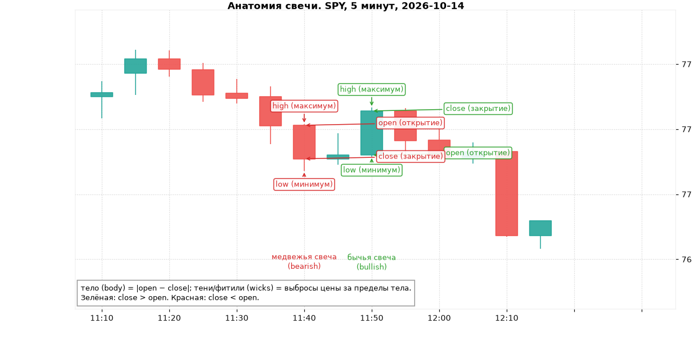
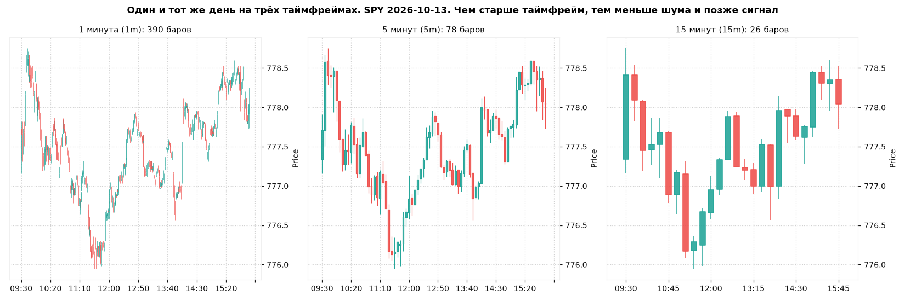
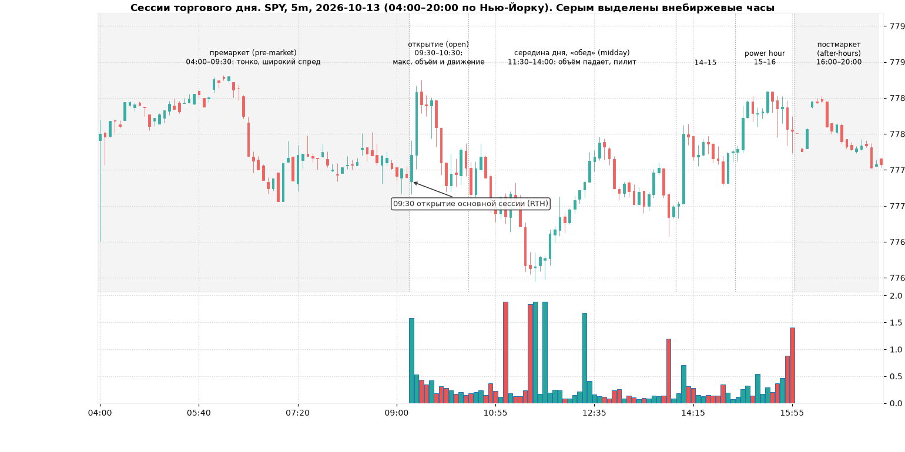
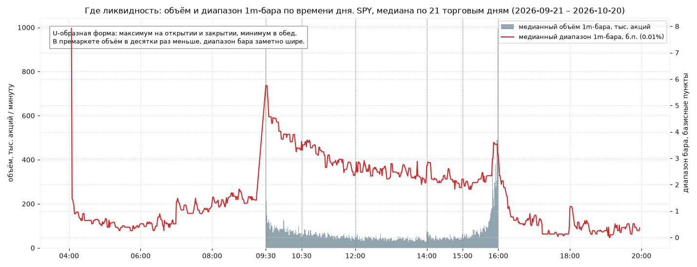
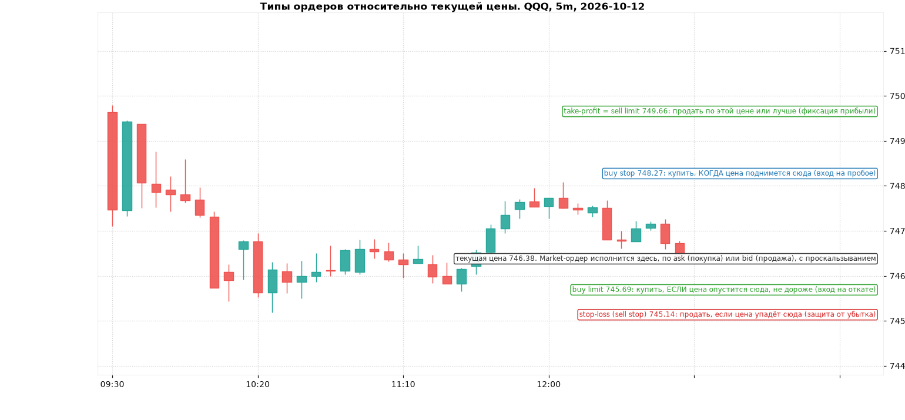

# Модуль 1. Основы: свечи, таймфреймы, сессии, спред, ликвидность, типы ордеров

> Что здесь: язык, на котором разговаривает график. Без него остальные модули читать нельзя.
> Все картинки построены на реальных данных (SPY, QQQ), таймфрейм и дата подписаны на каждой.

## 1.1. Свеча (candlestick)

Свеча сжимает все сделки за интервал времени в четыре числа, **OHLC**:

| Поле | По-английски | Что это |
|---|---|---|
| open | open | цена первой сделки интервала |
| high | high | максимальная цена за интервал |
| low | low | минимальная цена за интервал |
| close | close | цена последней сделки интервала |

- **Тело (body)** — прямоугольник между open и close. Длинное тело = сильное давление в одну сторону. Короткое тело = равновесие или безразличие.
- **Тени, фитили (wicks, shadows)** — тонкие линии выше и ниже тела. Длинная тень = цена туда сходила, но её вернули. Тень показывает *отвергнутые* цены, это важнее, чем кажется.
- **Цвет**: зелёная (бычья, bullish) при close > open, красная (медвежья, bearish) при close < open.

Как читать одну свечу (без контекста это почти ничего не значит, но нужно уметь):

- Большое тело без теней: кто-то агрессивно покупал или продавал весь интервал. Если такая свеча появляется на объёме выше среднего, движение обычно имеет продолжение в ближайшие бары (но не всегда, см. модуль 5).
- Маленькое тело и длинные тени с обеих сторон (**доджи**, doji): борьба без победителя.
- Длинная тень с одной стороны и маленькое тело на другом конце (**пин-бар**, pin bar): цену сходили «проверить» и быстро вернули. Это кандидат на разворот, если он стоит у значимого уровня.

Важное правило для живого графика: **свеча существует только после закрытия**. Пока бар формируется, его форма меняется каждую секунду. Паттерн на незакрытой свече — не паттерн. На тренажёре этой проблемы нет, бары всегда закрытые, но в реальной торговле это ошибка номер один у новичков.

## 1.2. Таймфреймы (timeframes)

Таймфрейм — длина интервала одной свечи. Для дей-трейдинга используют:

| Таймфрейм | Зачем | Особенность |
|---|---|---|
| **1 день (D)** | общий контекст: тренд, уровни за недели, гэпы | один бар = целый день, за него видно направление «большой» игры |
| **15 минут (15m)** | структура внутри дня, ключевые уровни дня | 26 баров в основной сессии |
| **5 минут (5m)** | основной рабочий таймфрейм для сетапов | 78 баров, баланс шума и скорости |
| **1 минута (1m)** | точка входа и стопа, первые минуты после открытия | 390 баров, много шума, сигналы быстрые, но ненадёжные |

Связь таймфреймов: 5m-бар = пять 1m-баров подряд. Его open = open первого, close = close последнего, high и low = экстремумы всех пяти. Поэтому «пробой на 1m» может оказаться просто тенью на 5m. Старший таймфрейм всегда главнее младшего по смыслу, но младший быстрее показывает изменения. Это фундаментальный компромисс, подробнее в модуле 8.

Практика: решение о направлении принимают на 15m/5m, точку входа и стоп ищут на 5m/1m. Торговать по одному 1m-графику без старшего контекста — классический способ слить депозит мелкими стопами.

## 1.3. Сессии торгового дня (trading sessions)

Американский рынок акций (NYSE, Nasdaq). Всё время ниже — Нью-Йорк (ET). В курсе и тренажёре время всегда в ET.

| Сессия | Время ET | Что происходит |
|---|---|---|
| **Премаркет** (pre-market) | 04:00–09:30 | Реакция на ночные новости и отчёты. Объём в десятки раз ниже, спред широкий, движения резкие и «пустые». Здесь формируются премаркет-максимум и минимум (PMH/PML) — уровни на день. 08:30 — выход макростатистики (CPI, payrolls), резкие импульсы. |
| **Открытие** (open) | 09:30–10:30 | Максимальный объём и волатильность дня. Первые 5–15 минут — хаос: исполняются ночные ордера, цена «ищет» равновесие. 09:30–10:00 формируется **opening range** (диапазон открытия). Большинство дей-трейдерских сетапов живут здесь. 10:00 — часто выходит статистика второго эшелона (ISM, потребительская уверенность). |
| **Середина дня / «обед»** (midday, lunch chop) | 11:30–14:00 | Объём падает, диапазоны баров сжимаются, много ложных пробоев. Опытные трейдеры здесь обычно не торгуют или торгуют меньше. |
| **Вторая половина** | 14:00–15:00 | Оживление; 14:00 — иногда решения ФРС по ставке (в дни FOMC, восемь раз в год), очень резкие движения. |
| **Power hour** | 15:00–16:00 | Объём снова растёт: закрытие дневных позиций, ребалансировки фондов. Последние 10 минут — подготовка к аукциону закрытия (closing auction, MOC-ордера), огромный объём на последней минуте. |
| **Постмаркет** (after-hours) | 16:00–20:00 | Отчёты компаний (обычно 16:05–16:30), тонкий рынок. |

Это не «мнение», это свойство данных. Ниже медианный объём и медианный диапазон 1-минутного бара SPY по времени суток за все торговые дни в кеше. U-образная форма: пик в первые минуты, спад к обеду, второй пик на закрытии.

Вывод для практики: **одно и то же движение в 10:00 и в 12:30 значит разное**. Пробой уровня на объёме в первый час — информация. Такой же пробой в 12:30 на объёме вдвое ниже среднего — чаще шум. Тренажёр считает статистику отдельно по часам дня именно поэтому.

## 1.4. Спред и ликвидность (spread, liquidity)

В каждый момент на рынке есть две цены:

- **bid** — лучшая цена, по которой кто-то готов *купить* у вас (вы по ней продаёте);
- **ask** (offer) — лучшая цена, по которой кто-то готов *продать* вам (вы по ней покупаете).

**Спред** = ask − bid. Это гарантированный убыток каждой сделки: купили по ask, мгновенно продать можете только по bid. Плюс **проскальзывание** (slippage): ваш рыночный ордер «съедает» несколько уровней книги, если объёма по лучшей цене не хватает.

**Ликвидность** = сколько можно купить или продать, не сдвинув цену. Складывается из объёма торгов и глубины книги заявок (order book). Признаки ликвидного инструмента: спред 1 цент (SPY, QQQ, AAPL, NVDA), десятки миллионов акций в день, плотная книга.

Почему это критично именно для дей-трейдинга:

- Дей-трейдер делает много сделок с маленькой целью. Если цель 0.3% от цены, а спред + проскальзывание 0.05%, вы отдаёте 1/6 потенциальной прибыли ещё до начала.
- Пример: акция по $5 со спредом 2 цента = 0.4% на вход и столько же на выход. При цели 1% половина ушла рынку.
- На SPY по $770 спред 1 цент = 0.0013%. Разница в 300 раз.

Правило курса: **торгуйте только инструменты, где спред меньше 1/20 вашего среднего стопа**. Поэтому список тренажёра — SPY, QQQ, IWM и крупные акции.

Важная оговорка по данным: в бесплатных данных (Yahoo) нет котировок bid/ask, только сделки. Поэтому спред в тренажёре не моделируется, а объём 1-минутных баров Yahoo содержит артефакты (отложенные крупные сделки печатаются одной минутой с объёмом в 50–300 раз больше медианы). В коде курса объём очищается каузально (срез по медиане предыдущих баров), подробности в README тренажёра.

## 1.5. Типы ордеров (order types)

| Ордер | Что делает | Когда применять |
|---|---|---|
| **Market** (рыночный) | исполнить сейчас по любой доступной цене | только на ликвидных инструментах и только когда скорость важнее цены (выход по стопу вручную). В премаркете — никогда. |
| **Limit** (лимитный) | купить не дороже X / продать не дешевле X | вход на откате к уровню, фиксация прибыли (take-profit). Может не исполниться, если цена не дошла. |
| **Stop** (стоп-маркет, stop-market) | когда цена коснётся X, выставить market-ордер | защитный стоп-лосс; вход на пробое (buy stop выше уровня). Исполнится, но цена исполнения не гарантирована. |
| **Stop-limit** | когда цена коснётся X, выставить limit по Y | вход на пробое с контролем цены. Опасен как стоп-лосс: при гэпе может не исполниться и оставить вас в убыточной позиции. |
| **Bracket / OCO** (one-cancels-other) | вход + стоп + цель одним пакетом; исполнение одного отменяет другой | стандарт для дисциплины: стоп выставлен до того, как вы успели «передумать». |
| **MOC / LOC** | market/limit on close, исполнение в аукционе закрытия | выход из позиции в конце дня по цене закрытия. |

Срок действия (time in force): **DAY** (до конца сессии), **GTC** (good till cancelled), **IOC** (immediate or cancel), **EXT** (действует в расширенные часы: там разрешены только лимитные).

Правила курса по ордерам:

1. Стоп-лосс — всегда **stop-market**, не stop-limit. Главная задача стопа — исполниться.
2. Вход на пробое — **stop** (buy stop над уровнем), вход на откате — **limit** на уровне. Не наоборот.
3. Стоп и цель выставляются **в момент входа** (bracket), не «потом».
4. Market-ордер только в основной сессии на инструментах со спредом в 1–2 цента.

## 1.6. Короткий словарь

- **Тик** (tick) — минимальный шаг цены, для акций дороже $1 это $0.01.
- **Базисный пункт** (bp) — 0.01%. Удобно сравнивать движения разных по цене инструментов.
- **Гэп** (gap) — разрыв между вчерашним закрытием и сегодняшним открытием.
- **Лонг / шорт** (long / short) — ставка на рост / на падение (шорт = продажа взятых взаймы акций).
- **R** — размер риска в сделке в деньгах (расстояние от входа до стопа × число акций). Результаты в курсе считаются в R, а не в долларах, см. модуль 9.
- **PDT** (pattern day trader) — правило США: на маржинальном счёте меньше $25 000 можно делать не более 3 дневных сделок за 5 торговых дней. Это ограничивает частоту торговли для маленьких счетов.
- **RTH** (regular trading hours) — основная сессия 09:30–16:00 ET.

## Типичные ошибки новичка на этом уровне

1. **Торговать первые 1–3 минуты после открытия.** Спред шире, проскальзывание большое, цена ещё не нашла равновесие. Даже профессионалы с ORB-сетапами ждут хотя бы 5 минут.
2. **Market-ордера в премаркете.** Спред может быть десятки центов, исполнение «куда попало».
3. **Принимать решение по незакрытой свече.** Бар переписывается до закрытия. Особенно на 5m и 15m: красивая бычья свеча за минуту до закрытия превращается в доджи.
4. **Смотреть только 1m.** Каждый пробой на 1m выглядит как событие; на 5m это тень.
5. **Путать время.** Yahoo и многие платформы по умолчанию показывают время в вашей локальной зоне. Все уровни сессий в курсе — ET.
6. **Торговать неликвидные инструменты «потому что они быстро ходят».** Быстро ходят в обе стороны, а спред делает математику отрицательной.
7. **Stop-limit в качестве стоп-лосса.** При резком движении он не исполняется, и убыток становится неограниченным.

## Чек-лист перед первым взглядом на график

- [ ] Время на графике в ET, я понимаю, в какой сессии сейчас цена.
- [ ] Я вижу 3 таймфрейма: D (контекст), 5m (сетап), 1m (вход).
- [ ] Инструмент ликвидный: спред 1–2 цента, объём > 5 млн акций в день.
- [ ] Я знаю, где премаркет-максимум/минимум и вчерашнее закрытие (их нанесём в модуле 2).
- [ ] Я знаю, какой ордер буду использовать для входа, стопа и цели, и выставляю их одним пакетом.
- [ ] Последняя свеча закрыта, прежде чем я называю что-то паттерном.

## Мини-тест

1. Свеча: open 100.0, high 101.2, low 99.9, close 101.0. Какого она цвета и что про неё можно сказать?
2. Чему равен high 5-минутной свечи, если пять минутных свечей внутри неё имели high: 50.1, 50.3, 50.2, 50.6, 50.4?
3. В какое время ET открывается основная сессия и когда объём обычно минимален?
4. Спред на акции $20 равен 4 цента. Сколько это в процентах, и во сколько раз это дороже, чем 1 цент на SPY по $770?
5. Вы хотите купить на пробое уровня 150.00. Какой тип ордера подходит для входа и какой для стоп-лосса?
6. Почему stop-limit опасен как защитный стоп?
7. Что такое PDT и кого оно касается?
8. На графике 5m текущая свеча «бычье поглощение», но до закрытия бара 2 минуты. Можно ли считать паттерн сформированным?
9. Назовите две причины, почему движение цены в 12:30 менее информативно, чем в 10:00.
10. Что означает длинная нижняя тень у свечи?

### Ответы

1. Зелёная (close > open). Тело 1.0 из диапазона 1.3, верхняя тень 0.2, нижняя 0.1: сильное покупательское давление, почти без отката.
2. 50.6 — максимум из максимумов.
3. 09:30 ET. Минимум объёма обычно 12:00–14:00 («обед»).
4. 4/2000 = 0.2%. На SPY 1/77000 ≈ 0.0013%, то есть примерно в 150 раз дешевле.
5. Вход: buy stop чуть выше 150.00 (например 150.05). Стоп-лосс: sell stop (stop-market) ниже уровня или ниже локального минимума.
6. При быстром движении цена проскакивает лимит, ордер не исполняется, позиция остаётся открытой с растущим убытком.
7. Pattern Day Trader: правило для маржинальных счетов в США меньше $25 000 — не более 3 дневных сделок за 5 торговых дней.
8. Нет. До закрытия бара форма может измениться. Решение принимают после закрытия, либо по 1m-подтверждению внутри бара, если это отдельно прописано в плане.
9. Объём вдвое-втрое ниже (меньше участников, пробои легче сделать ложными) и диапазоны баров меньше (цель и стоп сопоставимы со спредом/шумом).
10. Цену продавили вниз, но покупатели вернули её к открытию или выше: отказ от низких цен (rejection). Значимо у уровня, незначимо в середине пустого диапазона.
