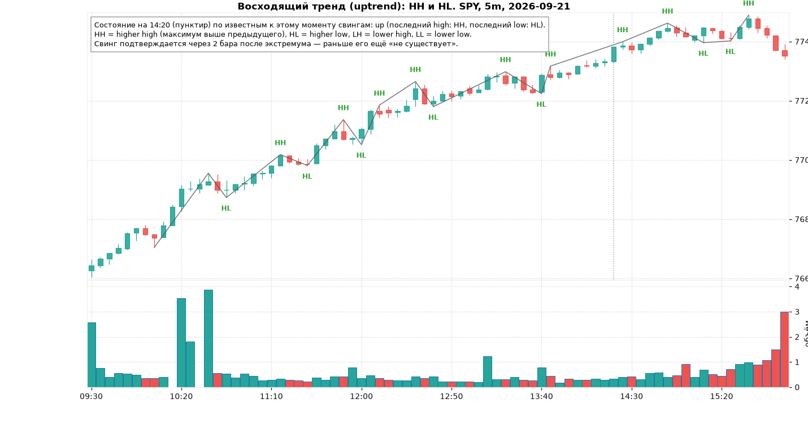
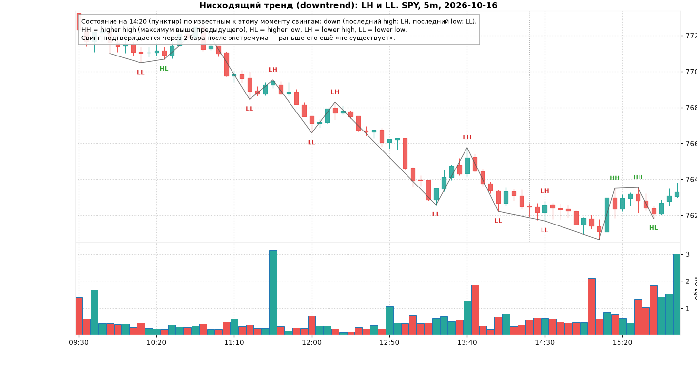
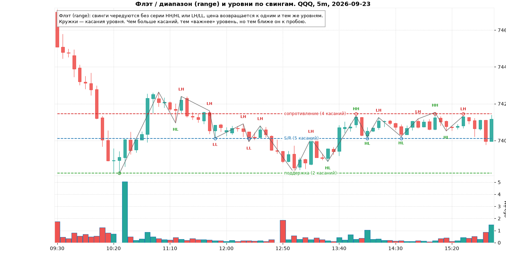
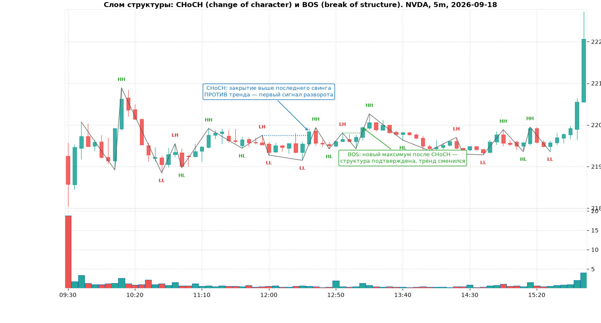
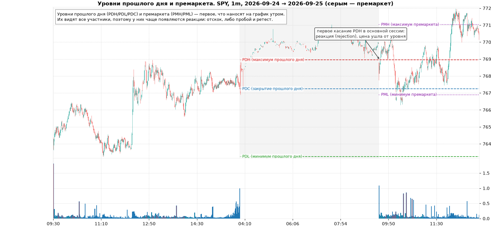
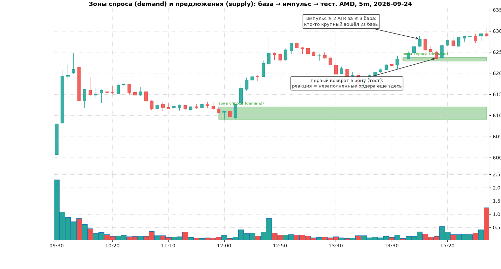
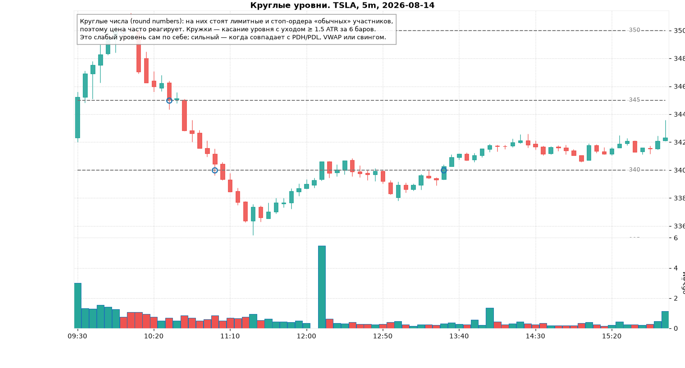

# Модуль 2. Структура рынка: тренд, флэт, свинги, слом структуры, уровни и зоны

> Что здесь: как увидеть на голом графике, кто сейчас сильнее, и где цена, скорее всего, отреагирует.
> Это самый важный модуль курса. Индикаторы (модуль 4) и паттерны (модули 5–6) лишь уточняют то, что видно по структуре.

## 2.1. Свинги (swings) — строительные блоки

Цена не движется по прямой: она делает шаг, откатывает, снова делает шаг. Точки разворота называются **свингами**:

- **свинг-хай** (swing high) — локальный максимум: бар, у которого high выше, чем у нескольких баров слева и справа;
- **свинг-лоу** (swing low) — локальный минимум.

В коде курса свинг определяется фрактально: high бара выше high двух баров слева и не ниже двух баров справа (параметры left/right = 2 на 5m, 3 на 1m). Это даёт важное следствие: **свинг известен только через `right` баров после экстремума**. Пока эти бары не закрылись, вы не знаете, что это был свинг. Тренажёр это учитывает: в разметке есть поле `confirmed_at`.

## 2.2. HH / HL / LH / LL и определение тренда

Сравниваем каждый свинг с предыдущим того же типа:

| Метка | Расшифровка | Смысл |
|---|---|---|
| **HH** | higher high | новый максимум выше предыдущего — покупатели продавливают |
| **HL** | higher low | откат закончился выше предыдущего минимума — продавцы слабее |
| **LH** | lower high | отскок не дотянул до прошлого максимума — покупатели слабее |
| **LL** | lower low | новый минимум ниже предыдущего — продавцы продавливают |

Определение (строгое, его использует тренажёр):

- **Восходящий тренд (uptrend)**: последний свинг-хай = HH **и** последний свинг-лоу = HL.
- **Нисходящий тренд (downtrend)**: последний свинг-хай = LH **и** последний свинг-лоу = LL.
- **Флэт / переход (range)**: всё остальное (HH + LL = расширение, LH + HL = сжатие).

Обратите внимание на нижнюю картинку: почти весь день чистый нисходящий тренд (серия LH и LL), но после 15:00 появляются два HH подряд: структура начинает ломаться. Один и тот же день может содержать несколько режимов. Поэтому состояние определяют **по последним свингам**, а не по всему дню.

В тренде торгуют **только в его сторону**: в аптренде покупают откаты к HL, в даунтренде продают отскоки к LH. Контртрендовый вход («уже слишком высоко») — самая дорогая ошибка новичков, см. модуль 12 про то, что говорит статистика о моментуме.

## 2.3. Флэт (range) и уровни по свингам

Во флэте свинги возвращаются к одним и тем же ценам. Если несколько свингов лежат в узкой полосе (в коде: в пределах 0.3–0.4 ATR друг от друга), они образуют горизонтальный уровень:

- **сопротивление** (resistance) — кластер свинг-хаев: здесь продавцы раз за разом останавливали рост;
- **поддержка** (support) — кластер свинг-лоу.

Правила работы с диапазоном:

1. Границы диапазона — это зоны, а не линии. Ширина зоны ≈ 0.3 ATR.
2. Покупать у поддержки, продавать у сопротивления **только** если есть реакция (свечной паттерн из модуля 5) и диапазон достаточно широкий: высота диапазона ≥ 3 × (стоп). Иначе R:R не сходится.
3. Чем больше касаний, тем уровень «виднее», но **тем вероятнее пробой**: каждое касание съедает лимитные ордера, которые его держали. Третье-четвёртое касание — уже место, где нужно думать о пробое, а не об отскоке.
4. Середина диапазона — зона без преимущества. Там не торгуют.

## 2.4. Слом структуры: BOS и CHoCH

Два события, которые меняют состояние:

- **BOS** (break of structure) — закрытие бара за последним свингом **по тренду**: в аптренде выше последнего HH. Это подтверждение продолжения.
- **CHoCH** (change of character) — закрытие бара за последним свингом **против тренда**: в даунтренде выше последнего LH. Первый признак разворота. Сам по себе ещё не аптренд; аптренд наступает, когда после CHoCH сформируется HL, а потом BOS вверх.

Последовательность разворота снизу вверх: LL → LH → **CHoCH** (закрытие выше LH) → откат, который держится выше LL (это HL) → **BOS** (закрытие выше нового максимума) → аптренд подтверждён. Торговать можно на откате после CHoCH (агрессивно) или после BOS (консервативно). Второй вариант даёт меньше сделок и лучший процент.

Важно: слом считается **по закрытию бара**, не по тени. Тень за уровень без закрытия — это, наоборот, признак ложного пробоя (модуль 7).

## 2.5. Уровни прошлого дня и премаркета

Самые объективные уровни, потому что их видят все:

| Уровень | Код | Почему работает |
|---|---|---|
| максимум прошлого дня | **PDH** (previous day high) | выше него нет «вчерашних» продавцов, стопы шортистов, цель для бычьих сетапов |
| минимум прошлого дня | **PDL** (previous day low) | симметрично |
| закрытие прошлого дня | **PDC** (previous day close) | точка отсчёта гэпа; «закрытие гэпа» = возврат к PDC (модуль 7) |
| максимум/минимум премаркета | **PMH / PML** (pre-market high/low) | утренняя реакция на новости; пробой PMH после открытия — классический триггер |
| максимум/минимум первых 5/15/30 минут | **ORH / ORL** (opening range high/low) | диапазон открытия, основа сетапа ORB (модуль 7) |
| текущие максимум/минимум дня | **HOD / LOD** (high/low of day) | динамические уровни, обновляются в течение дня |

Ритуал перед открытием (5 минут): нанести PDH, PDL, PDC, PMH, PML, ближайшие круглые числа и 1–2 уровня со старшего таймфрейма (модуль 8). Если уровни сходятся в одной зоне (например, PDH ≈ круглое число ≈ дневной свинг), эта зона важнее всех остальных: **конфлюэнция** (confluence).

Как цена ведёт себя у уровня (три сценария, других нет):

1. **Отскок** (rejection): касание, свеча с длинной тенью, уход. Торгуется разворотом от уровня (модуль 7).
2. **Пробой и ретест** (break and retest): закрытие за уровнем, возврат к нему, отскок уже с другой стороны. Самый надёжный вход по статистике курса.
3. **Ложный пробой** (fakeout): тень или даже закрытие за уровнем, а потом быстрый возврат. Торгуется в обратную сторону, стоп за экстремумом ложного пробоя.

## 2.6. Зоны спроса и предложения (demand / supply zones)

Идея: если из узкой области («базы») цена вылетела импульсом, значит, там стоял крупный участник, и его ордера, скорее всего, исполнились не полностью. При возврате цены в эту область он «докупит» (зона спроса) или «допродаст» (зона предложения).

Формальное определение в коде курса:

- база: 1–3 бара с диапазоном ≤ 1.2 ATR;
- импульс: за ≤ 3 бара цена ушла от базы на ≥ 2 ATR;
- зона = от минимума до максимума баров базы;
- зона «свежая» (fresh), пока не было первого возврата. Первый тест — самый сильный. Третий тест обычно ломает зону.

Чем отличается от обычного уровня: уровень — линия по свингам, зона — область по базе перед импульсом. На практике лучшие точки — там, где они совпадают.

## 2.7. Круглые числа (round numbers)

На ценах вида 100, 150, 340, 770 скапливаются лимитные ордера и стопы розничных участников, а также страйки опционов. Поэтому цена реагирует на них чаще, чем на произвольные значения.

Правила:

- Для акций $100–500 значимы шаг $5 и особенно $10; для SPY/QQQ (>$500) — $5 и $10; для акций $20–100 — $1 и $5.
- Круглое число — **слабый** уровень сам по себе. Сильный — в сочетании с PDH/PDL, VWAP (модуль 3) или свинг-уровнем.
- Стоп **никогда** не ставят ровно на круглом числе: там же стоят стопы всех остальных, и их любят «собирать» (stop hunt). Стоп ставят на несколько центов (или 0.1–0.2 ATR) за круглым числом.

## Типичные ошибки и ложные сигналы

1. **Называть трендом две свечи.** Тренд — это серия подтверждённых свингов (минимум HH + HL), а не наклон последних баров.
2. **Считать свинг, который ещё не подтверждён.** Пока не закрылись `right` баров после экстремума, это не свинг. На живом графике зигзаг-индикаторы перерисовываются именно поэтому.
3. **Пробой по тени.** Слом структуры и пробой уровня — только по закрытию бара. Тень за уровнем — чаще ловушка.
4. **Линии вместо зон.** Уровень шириной 0 центов не существует. Рисуйте зоны ±0.3 ATR, стоп ставьте за зоной, а не на ней.
5. **Торговать середину диапазона.** Там нет ни поддержки, ни сопротивления, R:R всегда плохой.
6. **Лишние уровни.** 15 линий на графике = 0 информации. Максимум 5–6 значимых уровней в пределах дневного диапазона.
7. **Покупать «потому что поддержка».** Уровень — место, где *ждут* сигнал, а не сам сигнал. Без реакции (свечи, объёма) у уровня входа нет.
8. **Игнорировать старший таймфрейм.** Поддержка на 5m внутри нисходящего тренда на D обычно просто точка остановки перед следующим LL.

## Чек-лист разметки перед сессией

- [ ] Нанесены PDH, PDL, PDC, PMH, PML (и ORH/ORL после 09:35 / 09:45 / 10:00).
- [ ] Отмечены ближайшие круглые числа.
- [ ] По D и 15m найдены 1–2 ближайших свинг-уровня/зоны.
- [ ] Определено состояние структуры на 5m: up / down / range — и какой свинг его ломает.
- [ ] Отмечены свежие зоны спроса/предложения на 5m и 15m.
- [ ] Уровни превращены в зоны (±0.3 ATR), всего не больше 6 на графике.
- [ ] Для каждой зоны записан план: ждать отскок / ждать пробой-ретест / ничего не делать.

## Мини-тест

1. Последние свинги на 5m: high = LH, low = HL. Какое состояние структуры?
2. В даунтренде бар закрылся выше последнего LH. Как называется событие и означает ли оно аптренд?
3. Чем отличается BOS от CHoCH?
4. Через сколько баров после экстремума свинг с параметром right = 3 становится известен?
5. Уровень сопротивления касался цены 5 раз за день. Вы собираетесь продать от него шестой раз. Что не так?
6. Назовите три уровня, которые нужно нанести до открытия, и один, который появляется после 09:45.
7. Что такое зона спроса и как она формируется?
8. Почему нельзя ставить стоп ровно на 150.00?
9. Цена на 5m пробила PDH тенью, но закрылась под ним. Это пробой?
10. Что такое конфлюэнция и зачем она?

### Ответы

1. Range (сжатие): LH + HL = треугольник/переход, не тренд.
2. CHoCH (change of character). Нет: это первый признак; аптренд подтверждается, когда сформируется HL и произойдёт BOS вверх.
3. BOS — закрытие за свингом по направлению текущего тренда (продолжение); CHoCH — против тренда (возможный разворот).
4. Через 3 бара (confirmed_at = idx + 3).
5. Каждое касание съедает защищающие уровень ордера; после 4–5 касаний вероятность пробоя выше вероятности отскока. Нужен либо пропуск сделки, либо план на пробой.
6. PDH, PDL, PDC (а также PMH/PML, круглые числа); после 09:45 появляются OR15H/OR15L (диапазон первых 15 минут).
7. Область 1–3 узких баров (база), из которой цена вышла импульсом ≥ 2 ATR за ≤ 3 бара вверх. Считается, что там остались неисполненные покупки.
8. На круглом числе стоят стопы большинства участников, и цена часто заходит туда «за стопами» перед разворотом. Стоп ставят за уровнем на 0.1–0.2 ATR.
9. Нет. Пробой считается по закрытию бара. Тень над PDH с закрытием под ним — признак ложного пробоя, кандидат на шорт при подтверждении.
10. Совпадение нескольких независимых уровней (например PDH + круглое число + зона спроса) в одной ценовой области. Такая зона важнее любого отдельного уровня: больше участников на неё смотрят и больше ордеров там стоит.
