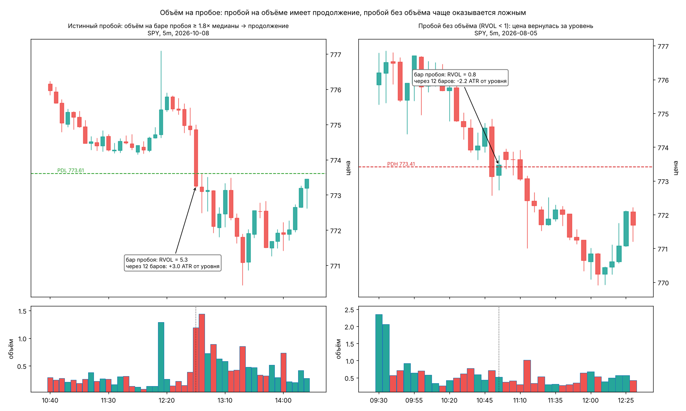
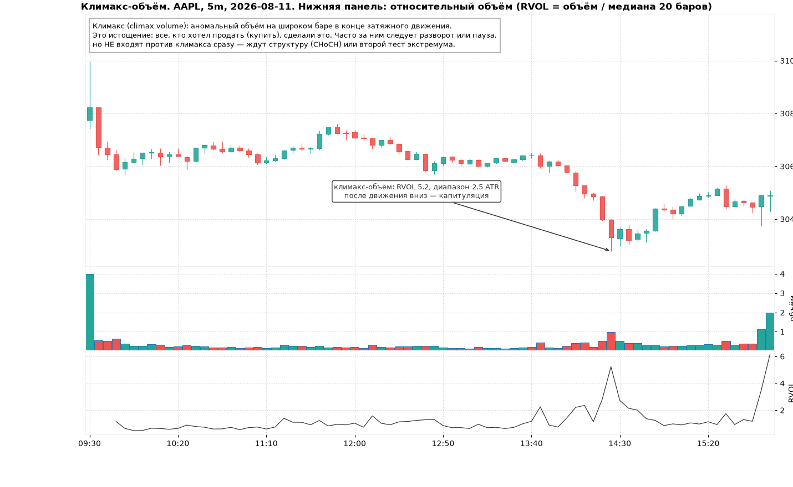
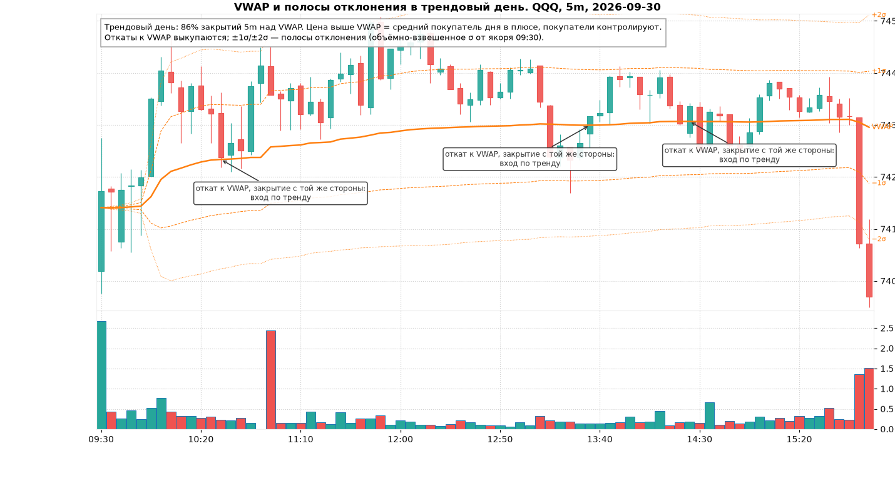
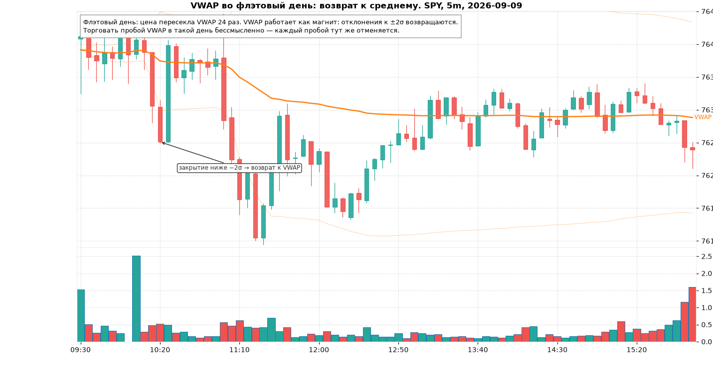
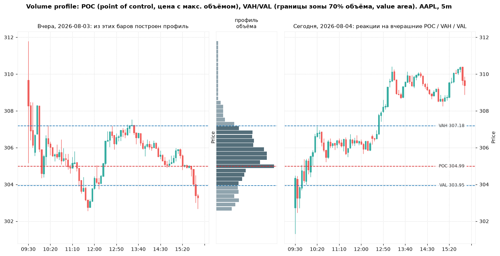

# Модуль 3. Объём, VWAP и профиль объёма

> Что здесь: цена говорит *куда*, объём говорит *насколько всерьёз*. VWAP — единственный «индикатор», который реально используют крупные участники, потому что по нему оценивают качество исполнения.

## 3.1. Что такое объём и как его читать

**Объём** (volume) — число акций, сменивших владельца за интервал. Сам по себе абсолютный объём мало значит (у SPY и у маленькой акции разные масштабы), поэтому смотрят **относительный объём**:

> **RVOL** (relative volume) = объём бара / медиана объёма предыдущих N баров (в курсе N = 20, медиана вместо среднего, чтобы один выброс не портил базу).

Интерпретация:

| RVOL | Что значит |
|---|---|
| < 0.7 | интерес низкий: движение «на пустом», легко отменяется |
| 0.7–1.5 | норма |
| 1.5–2.5 | повышенный интерес: пробой или импульс с таким объёмом имеет шансы на продолжение |
| > 2.5–3 | аномалия: новость, крупный игрок или климакс. Сам по себе не говорит о направлении |

Про данные. В бесплатных минутных данных Yahoo объём ненадёжен: встречаются одиночные бары с объёмом в 50–300 раз больше медианы (отложенные блочные сделки печатаются одной минутой), а сумма объёма по 5m-барам за день заметно меньше дневного объёма. В коде курса объём **винзоризуется каузально**: бар не может быть больше 8× медианы предыдущих 30 баров того же типа сессии (для VWAP — 4×). Это убирает выбросы, но не возвращает пропущенный объём. Для серьёзной работы с объёмом нужен платный или брокерский фид (в тренажёре есть провайдер Alpaca).

## 3.2. Объём на пробое

Пробой уровня (PDH, PDL, ORH, свинг) — главное место, где объём помогает. Логика: чтобы цена прошла уровень, где стоят лимитные ордера, кто-то должен их «съесть». Если объёма нет, пробой сделан несколькими сделками в пустоте и легко откатывается.

Проверка на данных курса. Для всех 10 тикеров кеша взяты первые за день пробои PDH/PDL по закрытию 5m-бара (276 пробоев за 59 дней). Смотрели, где цена через 12 баров (1 час) относительно уровня и вернулась ли она за уровень в первые 6 баров:

| RVOL на баре пробоя | число пробоев | медиана ухода через 1 час, ATR | доля продолжений (> 0.5 ATR) | доля возвратов за уровень в первые 30 мин |
|---|---|---|---|---|
| < 1.0 | 131 | 0.13 | 32% | 82% |
| 1.0–1.5 | 79 | 0.19 | 35% | 77% |
| 1.5–2.5 | 43 | 0.73 | 60% | 63% |
| > 2.5 | 23 | 0.03 | 35% | 65% |

Выводы, которые из этого следуют (и которые не следуют):

1. Пробой без объёма (RVOL < 1) в 4 случаях из 5 возвращается за уровень в течение получаса. Это **не** торгуется как пробой. Это кандидат на ложный пробой (модуль 7).
2. Умеренно повышенный объём (1.5–2.5) даёт в два раза больше продолжений. Это зона, где пробой имеет смысл.
3. Экстремальный объём (> 2.5) **не** улучшает результат: часто это новостной выброс или климакс, после которого движение заканчивается. Объём помогает не монотонно.
4. Выборка маленькая (23–131 случая на корзину), один период, без учёта спреда. Это иллюстрация метода, а не доказательство. Как измерять такие вещи честно — модуль 12.

Правило курса: **пробой торгуется только при RVOL ≥ 1.5 на баре пробоя или при ретесте уровня** (ретест не требует объёма: там, наоборот, хорош *падающий* объём на откате).

## 3.3. Климакс-объём (climax volume)

После затяжного движения приходит бар с аномальным объёмом и широким диапазоном. Все, кто хотел продать (при падении) или купить (при росте), сделали это одновременно. Это **истощение** (exhaustion): кульминация продавцов называется капитуляцией (capitulation), кульминация покупателей — эйфорией (euphoria, blow-off top).

Формально в коде: движение ≥ 2 ATR за 8 баров, затем бар с RVOL ≥ 2.5 и диапазоном ≥ 1.5 ATR.

Что с этим делать:

- **Не входить против климакса сразу.** Климакс-бар может быть первым из трёх. Правильная последовательность: климакс → пауза или второй тест экстремума на *меньшем* объёме → CHoCH (модуль 2) → вход.
- Если вы в позиции по тренду, климакс — сигнал **фиксировать** хотя бы часть: лучшая цена за движение обычно рядом.
- Климакс на открытии (первые 5 минут) — не климакс, а нормальный объём открытия. Детектор требует предшествующего движения именно поэтому.

## 3.4. VWAP

**VWAP** (volume-weighted average price) — средняя цена дня, взвешенная по объёму:

> VWAP = Σ(типичная цена × объём) / Σ(объём), где типичная цена = (high + low + close) / 3, суммы накапливаются с открытия основной сессии (09:30).

Почему это не просто ещё одна средняя:

- Институциональные алгоритмы исполнения оценивают себя относительно VWAP. Фонд, который покупает весь день, старается купить ниже VWAP; при отклонении цены ниже VWAP он ускоряет покупки. Это создаёт реальный, а не нарисованный спрос.
- VWAP = средняя цена, по которой сегодня купили все. Цена выше VWAP → средний покупатель дня в плюсе и не собирается продавать; ниже → средний покупатель в минусе, при возврате к VWAP он «выходит в ноль» и продаёт. Это объясняет, почему VWAP работает как поддержка/сопротивление.

В курсе VWAP считается от 09:30 (премаркет не включается, в премаркете VWAP не показывается). Некоторые платформы считают с 04:00. Разница небольшая, но знайте, что у вашего брокера.

**Полосы отклонения** (VWAP bands) — VWAP ± k·σ, где σ — объёмно-взвешенное стандартное отклонение цены от VWAP с якоря. ±1σ — «нормальное» удаление, ±2σ — растянутость. В трендовый день цена живёт между VWAP и +2σ (или −2σ), во флэтовый — качается вокруг VWAP и возвращается от ±2σ.

Три способа использовать VWAP (подробно как сетапы — модуль 7):

1. **Фильтр направления.** Выше VWAP — только лонги, ниже — только шорты. Одно это правило убирает половину убыточных сделок новичка.
2. **Откат к VWAP в тренде** (VWAP pullback). В трендовый день первое-второе касание VWAP выкупается. Вход на закрытии бара, который коснулся VWAP и закрылся с «правильной» стороны, стоп за VWAP на 0.3–0.5 ATR.
3. **Reclaim / reject.** Цена была под VWAP, закрепилась над ним (две свечи закрылись выше) — reclaim, покупатели вернули контроль. Подошла снизу, не смогла закрепиться — reject.

Чего VWAP не умеет: он ничего не говорит о будущем направлении в первые 10–15 минут дня (слишком мало данных), и он бесполезен в день, когда цена пересекает его десятки раз (см. картинку флэтового дня: 24 пересечения). Если к 10:30 цена пересекла VWAP уже 5+ раз, это флэтовый день, и VWAP-сетапы на сегодня отменяются.

## 3.5. Профиль объёма (volume profile)

Обычная гистограмма объёма показывает, **когда** торговали. Профиль объёма показывает, **по каким ценам** торговали: объём каждого бара распределяется по его диапазону high–low, и строится гистограмма по цене.

- **POC** (point of control) — цена с максимальным объёмом. «Справедливая цена» периода, магнит.
- **Value area** (VA) — диапазон вокруг POC, в котором прошло 70% объёма. Границы — **VAH** (value area high) и **VAL** (value area low).

Как это использовать на следующий день:

| Где открылись относительно вчерашней VA | Ожидание |
|---|---|
| внутри VA | день с большой вероятностью флэтовый: торговля от VAL к VAH и обратно, POC — магнит |
| выше VAH и удержались в первые 30 мин | принятие новых цен (acceptance): трендовый день вверх, VAH становится поддержкой |
| выше VAH, но вернулись внутрь | отказ (rejection): цель — POC, затем VAL |

Профиль можно строить по любому окну: вчерашний день, последние 5 дней, текущая сессия с открытия (developing profile). В тренажёре в разборе показывается профиль видимых баров: POC/VAH/VAL считаются только по тому, что было видно до точки обрыва.

## Типичные ошибки и ложные сигналы

1. **Объём подтверждает всё.** Объём — не направление. Большой объём на красном баре у поддержки может быть и капитуляцией (разворот), и пробоем (продолжение). Решает структура и закрытие бара.
2. **Сравнивать объём с «обычным» на глаз.** В 09:35 объём всегда большой, в 12:30 всегда маленький. Нужен RVOL относительно того же времени дня или хотя бы относительно соседних баров.
3. **Верить одиночному бару объёма из бесплатных данных.** См. про артефакты выше.
4. **Торговать VWAP в первые 10 минут.** VWAP ещё ничего не значит, он равен цене первых баров.
5. **Шортить «потому что выше VWAP на 2σ».** В трендовый день цена может висеть у +2σ часами. Растянутость — не сигнал, сигнал — структура (LH после HH) плюс растянутость.
6. **Считать POC уровнем входа.** POC — магнит и цель, а не место для входа. Входят от VAH/VAL или от реакции на POC, но не на самом POC без реакции.
7. **Путать климакс с объёмом открытия.** Первые 5 минут — не климакс.

## Чек-лист

- [ ] На графике есть RVOL (или хотя бы гистограмма объёма с медианой), а не только цена.
- [ ] Нанесён VWAP с якорем 09:30 и полосы ±1σ, ±2σ.
- [ ] Нанесены POC, VAH, VAL вчерашнего дня.
- [ ] Записано, где открылись относительно VA и VWAP, и какой тип дня это предполагает.
- [ ] Для пробоя: RVOL ≥ 1.5 на баре пробоя, иначе жду ретест.
- [ ] Для климакса: не вхожу против него без структуры, фиксирую часть позиции по тренду.
- [ ] К 10:30 посчитал пересечения VWAP: ≥ 5 → день флэтовый, VWAP-сетапы отменяются.

## Мини-тест

1. Бар пробоя PDH имеет RVOL 0.8. Что говорит статистика модуля о вероятности возврата за уровень в ближайшие 30 минут?
2. Что такое RVOL и почему в курсе используется медиана, а не среднее?
3. Почему VWAP — поддержка в трендовый день? Назовите две причины.
4. Цена ниже VWAP весь день. Какие сделки разрешены по правилу фильтра направления?
5. Что такое POC и VA? Какую долю объёма охватывает VA?
6. Открытие выше вчерашней VAH, через 30 минут цена вернулась внутрь VA. Какая первая цель?
7. После падения на 3 ATR за 8 баров пришёл красный бар с RVOL 4 и диапазоном 2 ATR. Что это и что делать?
8. К 10:30 цена пересекла VWAP 7 раз. Какой это тип дня и что отменяется?
9. Почему бар с RVOL > 2.5 на пробое не улучшает результат по данным модуля?
10. Как в курсе защищаются от артефактов объёма в данных и почему способ каузальный?

### Ответы

1. По таблице: при RVOL < 1 около 82% пробоев вернулись за уровень в первые 6 баров (30 мин). Пробой не торгуется.
2. Объём бара / медиана объёма предыдущих 20 баров. Медиана устойчива к одиночным выбросам, которых в данных много.
3. Алгоритмы исполнения фондов покупают ниже VWAP (реальный спрос); средний покупатель дня в плюсе выше VWAP и не продаёт, а при касании докупает.
4. Только шорты (или ничего). Лонги запрещены до reclaim VWAP.
5. POC — цена с максимальным объёмом за период; VA — диапазон вокруг POC с 70% объёма, границы VAH и VAL.
6. POC вчерашнего дня (затем VAL).
7. Климакс-объём, капитуляция. Не покупать сразу; ждать паузы/второго теста минимума на меньшем объёме и CHoCH; если в шорте — фиксировать.
8. Флэтовый день. VWAP-сетапы (pullback, reclaim/reject) отменяются, работает возврат от ±2σ к VWAP.
9. Экстремальный объём чаще означает новость или климакс: движение исчерпывается на самом баре пробоя. В данных такие пробои продолжались лишь в 35% случаев.
10. Каузальная винзоризация: объём бара ограничивается 8× медианы предыдущих 30 баров того же типа сессии (4× для VWAP). Используются только прошлые бары, поэтому результат не меняется при добавлении будущих данных.
