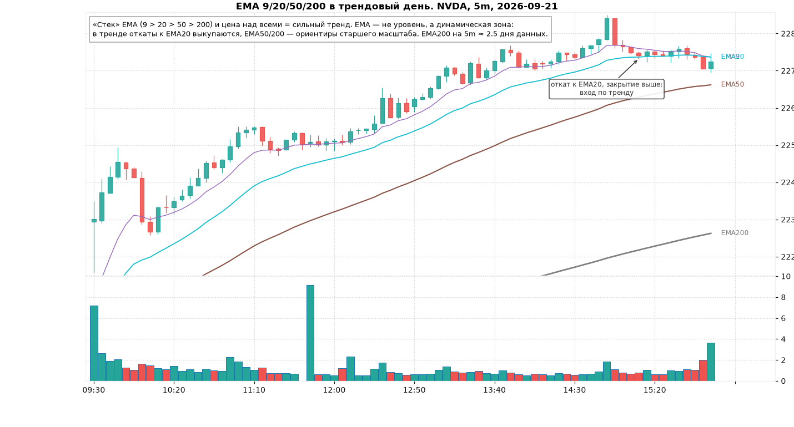
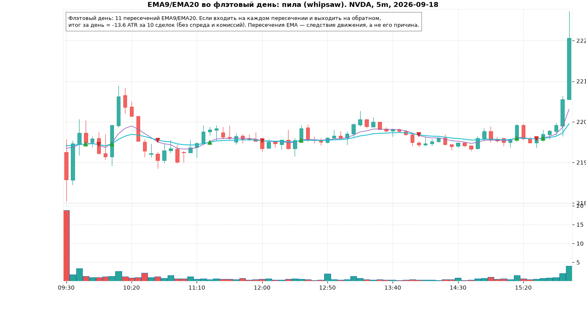
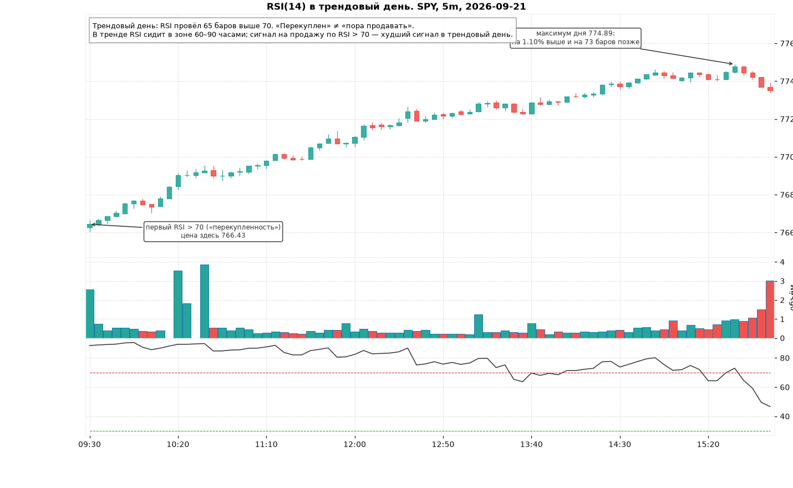
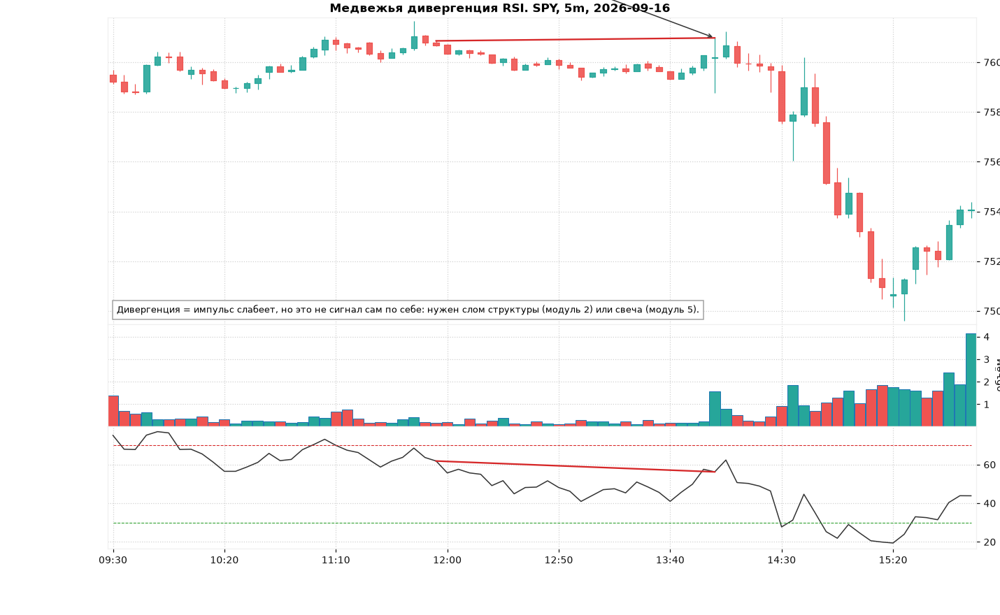
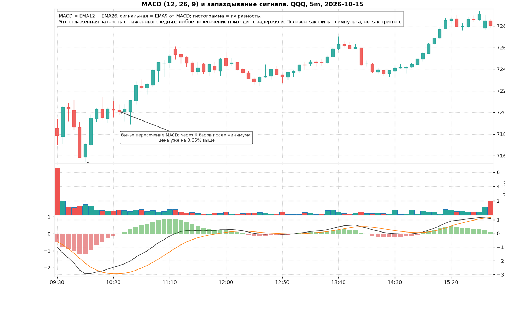
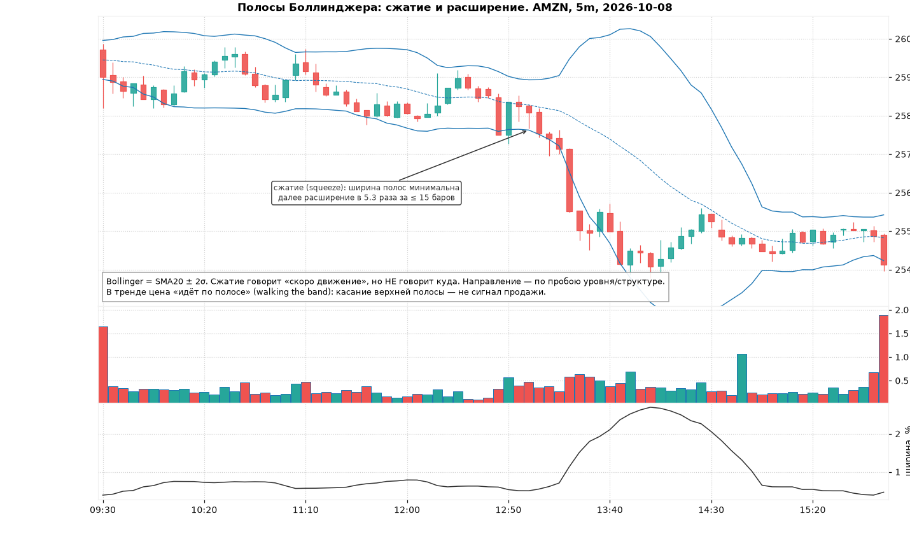
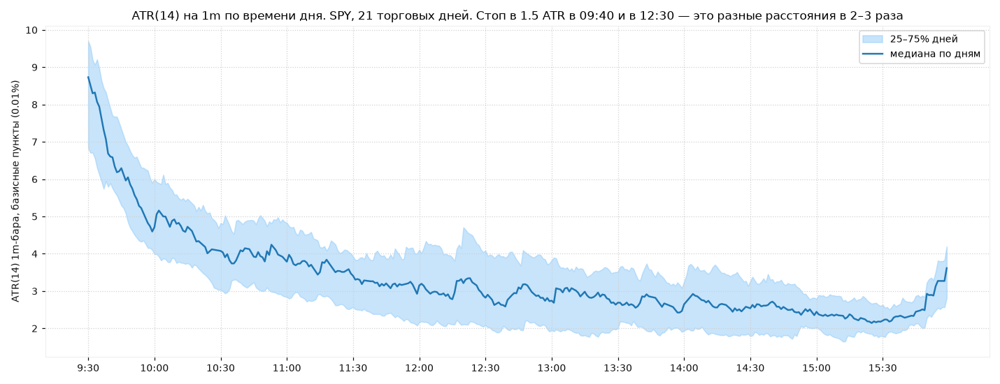
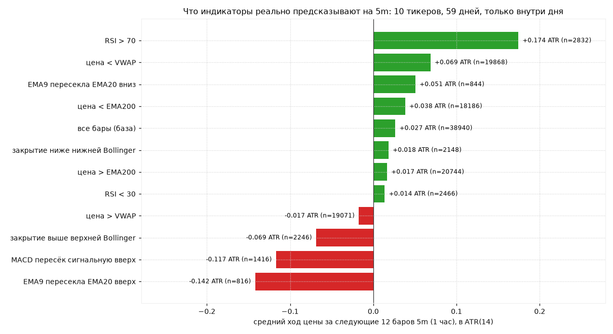

# Модуль 4. Индикаторы: EMA, RSI, MACD, Bollinger, ATR

> Что здесь: что каждый индикатор *на самом деле* вычисляет, что он поэтому может и не может показать, и почему по одному индикатору торговать нельзя. В конце — проверка на данных курса: что происходит с ценой после классических «сигналов».

Главная мысль модуля: **индикатор — это функция от прошлых цен**. Он не содержит информации, которой нет на голом графике. Он лишь сжимает её и показывает под другим углом (сглаживает, нормирует, сравнивает). Поэтому индикатор не может «предсказать» то, чего не видно в структуре и объёме; он может помочь это быстрее *увидеть*.

## 4.1. Скользящие средние: EMA 9 / 20 / 50 / 200

**EMA** (exponential moving average) — экспоненциально взвешенная средняя цена закрытия: EMA_t = α·close_t + (1−α)·EMA_{t−1}, α = 2/(N+1). Недавние цены весят больше, поэтому EMA реагирует быстрее простой SMA.

Что показывает: среднюю цену за «последние N баров» с акцентом на свежие. Наклон EMA = направление, расстояние цены от EMA = растянутость.

| EMA | На 5m это | Для чего |
|---|---|---|
| 9 | ~45 минут | импульс: в сильном тренде цена не закрывается за EMA9 |
| 20 | ~1.5 часа | «рабочая» динамическая поддержка/сопротивление для откатов |
| 50 | ~4 часа (половина дня) | старший контекст внутри дня |
| 200 | ~2.5 дня | многодневный контекст; выше/ниже EMA200 = бычий/медвежий режим |

**Стек EMA**: 9 > 20 > 50 > 200 и цена выше всех = выровненный аптренд. Это самый полезный способ смотреть на EMA: не пересечения, а порядок и наклон.

Когда врут:

- **Пересечения во флэте.** EMA9/EMA20 пересекаются каждые 5–10 баров, каждое пересечение = убыток. На картинке ниже 11 пересечений за день и минус 13.6 ATR, если торговать каждое.
- **Запаздывание.** Пересечение EMA происходит после того, как движение уже случилось. Вход по пересечению = вход в конце импульса, перед откатом. Это видно и в статистике ниже: после бычьего пересечения EMA9/20 цена в среднем *падает* в следующий час.
- **Иллюзия уровня.** EMA — не уровень; цена не «отскакивает от EMA20», она отскакивает от зоны, в которую EMA20 в тот момент попала. Если EMA20 совпадает с VWAP или PDH, зона сильная; одна EMA20 — слабая.

## 4.2. RSI (relative strength index)

RSI(14) = 100 − 100 / (1 + средний рост / среднее падение) за 14 баров (среднее по Уайлдеру, то есть EMA с α = 1/14). Диапазон 0–100.

Что показывает: насколько односторонним было движение за последние 14 баров. RSI 80 = почти все 14 баров росли. Это **мера импульса**, а не «перекупленности».

Когда врёт — главный случай: **трендовый день**. RSI уходит выше 70 в первый час и сидит там до закрытия, пока цена растёт ещё на процент. Каждая продажа «по перекупленности» — убыток.

Когда полезен:

- **Дивергенция** (divergence): цена делает новый максимум, RSI — нет. Импульс слабеет. Это не сигнал на вход, это сигнал *ждать* слома структуры (модуль 2) или разворотной свечи (модуль 5).
- Во флэтовый день (определили по VWAP, модуль 3) RSI < 30 у поддержки диапазона / RSI > 70 у сопротивления — подтверждение растянутости, но вход всё равно по реакции цены.

## 4.3. MACD

MACD = EMA12 − EMA26. Сигнальная линия = EMA9 от MACD. Гистограмма = MACD − сигнальная.

Что показывает: разницу двух сглаженных средних, ещё раз сглаженную. То есть **дважды запаздывающую оценку импульса**. Положительная и растущая гистограмма = импульс вверх усиливается; гистограмма сокращается = импульс выдыхается (это полезно); пересечение линий = движение давно идёт (это бесполезно как вход).

На картинке: минимум дня, затем бычье пересечение MACD через 6 баров (30 минут), когда цена уже на 0.65% выше. Для дей-трейдера это 2–3 ATR опоздания.

Как использовать правильно: только как фильтр. Например, сокращение гистограммы после климакс-объёма подтверждает истощение; длинная серия растущих столбцов подтверждает трендовый день. Как триггер — нет.

## 4.4. Полосы Боллинджера (Bollinger Bands)

Середина = SMA20, полосы = ±2 стандартных отклонения close за 20 баров. **Ширина** (bandwidth) = (верх − низ) / середина.

Что показывает: текущую волатильность (ширина) и где цена относительно своего недавнего разброса.

Когда полезен: **сжатие** (squeeze). Узкие полосы = затишье, за которым статистически следует расширение. Сжатие говорит «скоро движение», но **не говорит куда**. Направление определяют по пробою уровня и объёму (модули 2–3).

Когда врёт: «цена у верхней полосы — продавай». В тренде цена идёт по полосе (walking the band) много баров подряд. Статистически (таблица ниже) закрытие выше верхней полосы на 5m даёт слабый средний откат, но это не компенсирует стоп.

## 4.5. ATR (average true range)

True range бара = max(high − low, |high − prev close|, |low − prev close|). ATR(14) — среднее по Уайлдеру за 14 баров.

Что показывает: **типичный размер бара прямо сейчас**. Это единственный индикатор в курсе, который используется не как сигнал, а как линейка:

- Стоп = экстремум сетапа ± 0.2–0.5 ATR, но не меньше 1 ATR от входа (иначе выбьет шумом).
- Цель = k × ATR или по высоте фигуры (модуль 6), сравнивают с ATR, чтобы понять, реалистична ли.
- Порог «флэта» в тренажёре: движение за N баров меньше k·ATR·√N — это флэт.
- Фильтр: если расстояние до стопа > 2 ATR, сетап «широкий», размер позиции уменьшается (модуль 9).

ATR меняется в течение дня в 2–3 раза, поэтому стоп, посчитанный в 09:35, в 12:30 слишком широкий, и наоборот.

## 4.6. Честная проверка: что происходит после «сигналов»

Для всех 10 тикеров и 59 дней на 5m посчитан средний ход цены за следующие 12 баров (1 час) после каждого классического условия, в ATR. Только внутри дня (сигналы ближе часа к закрытию отброшены). Без спреда и комиссий.

| Условие на баре | n | средний ход за 1 час, ATR | доля роста |
|---|---|---|---|
| RSI > 70 | 2832 | **+0.17** | 54% |
| цена < VWAP | 19868 | +0.07 | 51% |
| EMA9 пересекла EMA20 вниз | 844 | +0.05 | 53% |
| все бары (база) | 38940 | +0.03 | 50% |
| RSI < 30 | 2466 | +0.01 | 50% |
| закрытие выше верхней Bollinger | 2246 | −0.07 | 48% |
| MACD пересёк сигнальную вверх | 1416 | −0.12 | 47% |
| EMA9 пересекла EMA20 вверх | 816 | **−0.14** | 47% |

Что из этого следует:

1. **«Перекупленность» по RSI — не сигнал продажи, а признак тренда.** После RSI > 70 цена в среднем продолжает расти (+0.17 ATR за час, лучший результат таблицы). Это интрадей-моментум, см. модуль 12.
2. **Пересечения (EMA, MACD) запаздывают настолько, что в среднем дают откат против сигнала.** Вход по бычьему пересечению = покупка в конце импульса.
3. **RSI < 30 ничего не предсказывает** (+0.01, доля роста 50%): «перепроданность» на 5m — просто шум.
4. **Эффекты крошечные.** ±0.1–0.2 ATR за час при типичном стопе в 1 ATR. Ни одно из этих условий само по себе не является торговой системой. Нужен контекст: уровень, структура, объём, время дня.
5. **Это не доказательство.** Выборки перекрываются (соседние бары дают почти одинаковые сигналы), период один, рынок за эти 59 дней мог быть нетипичным. В модуле 12 — как такие проверки делают честно, и что известно из больших исследований.

## Почему нельзя торговать по одному индикатору

1. Все индикаторы считаются из одних и тех же цен. Три индикатора, показывающие одно и то же, — это одно подтверждение, а не три (**коллинеарность**).
2. Каждый индикатор оптимизирован под один режим: трендовые (EMA, MACD) теряют во флэте, осцилляторы (RSI, Bollinger) теряют в тренде. Режим определяется структурой и VWAP, то есть *до* индикатора.
3. Любое пороговое правило («RSI > 70») можно подобрать под историю. Чем больше параметров, тем проще подогнать и тем хуже вне выборки (**переобучение**, overfitting).
4. Стоимость сделки (спред + комиссия) сопоставима с «эффектами» из таблицы. Сигнал без преимущества минус издержки = гарантированный минус.

Как использовать индикаторы в курсе: **один для режима, один для линейки, остальные по желанию как фильтр**. Режим: VWAP + стек EMA. Линейка: ATR. Фильтр: RSI-дивергенция, сокращение гистограммы MACD, сжатие Bollinger. Триггер входа — всегда цена (структура, свеча, уровень), никогда индикатор.

## Типичные ошибки

1. Продавать по RSI > 70 в трендовый день.
2. Входить по пересечению EMA/MACD; это вход в конце движения.
3. Ставить стоп фиксированным процентом вместо ATR; в 09:35 выбьет, в 12:30 слишком далеко.
4. Нагружать график пятью индикаторами, которые показывают одно и то же.
5. Верить «подтверждению» индикатора, когда структура говорит обратное.
6. Торговать Bollinger-сжатие «в сторону последней свечи» без уровня.
7. Подбирать период индикатора под красивую историю (RSI 7 vs 14 vs 21) вместо того, чтобы спросить, что индикатор измеряет.

## Чек-лист

- [ ] Режим дня определён по VWAP и стеку EMA (тренд/флэт), а не по осциллятору.
- [ ] ATR известен, стоп и цель выражены в ATR.
- [ ] RSI используется только для дивергенций и только во флэте как подтверждение.
- [ ] MACD/Bollinger — только фильтр, не триггер.
- [ ] На графике не больше 3 индикаторов: VWAP, EMA20 (и/или 9/50), ATR в уголке.
- [ ] Вход всегда по цене (уровень + свеча/структура), индикатор лишь «не против».

## Мини-тест

1. Что такое EMA200 на 5m в днях и что значит цена ниже неё?
2. Почему пересечение EMA9/EMA20 — плохой триггер входа? Назовите две причины.
3. RSI(14) = 82 в 11:00 в день, когда цена с открытия растёт без откатов. Что это значит и что делать?
4. Что такое дивергенция RSI и что делать после неё?
5. MACD дал бычье пересечение. Насколько, по картинке модуля, он опоздал к минимуму?
6. Что говорит сжатие Bollinger и чего не говорит?
7. Стоп в 1.5 ATR в 09:40 и в 12:30 для SPY: во сколько раз они отличаются (по картинке ATR)?
8. Какое из условий таблицы дало наибольший средний ход и в какую сторону?
9. Почему три индикатора, подтверждающих друг друга, — не три подтверждения?
10. Что в курсе является триггером входа, а что фильтром?

### Ответы

1. ≈ 2.5 торговых дня (200 × 5 мин / 390 мин). Цена ниже EMA200 — медвежий многодневный режим, лонги только у сильных уровней с подтверждением.
2. Запаздывание (пересечение после того, как движение уже произошло) и пила во флэте (десяток ложных пересечений за день). Статистически после бычьего пересечения цена в среднем падает в следующий час.
3. Трендовый день; RSI показывает силу импульса, а не перекупленность. Не шортить; искать откаты к EMA20/VWAP для лонга.
4. Цена обновила экстремум, RSI — нет. Импульс слабеет. Ждать CHoCH (модуль 2) или разворотную свечу у уровня (модуль 5); сама дивергенция не триггер.
5. На 6 баров (30 минут), цена уже на 0.65% выше минимума.
6. Говорит: волатильность сжалась, вероятно скорое расширение. Не говорит: в какую сторону.
7. Примерно в 2–3 раза (ATR 1m ≈ 8–9 б.п. в 09:30–09:40 против ≈ 3 б.п. в 12:30).
8. RSI > 70: +0.17 ATR, продолжение роста.
9. Они вычислены из одних и тех же цен (коллинеарны). Это одно и то же наблюдение, показанное трижды.
10. Триггер — цена: уровень + структура/свеча + объём. Индикаторы (VWAP, EMA-стек — режим; ATR — линейка; RSI/MACD/Bollinger — фильтры).
