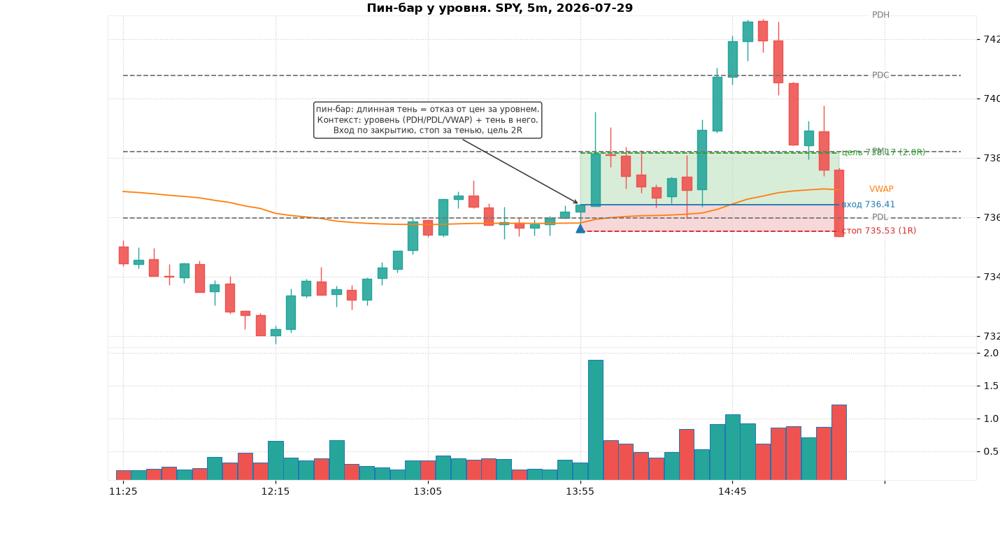
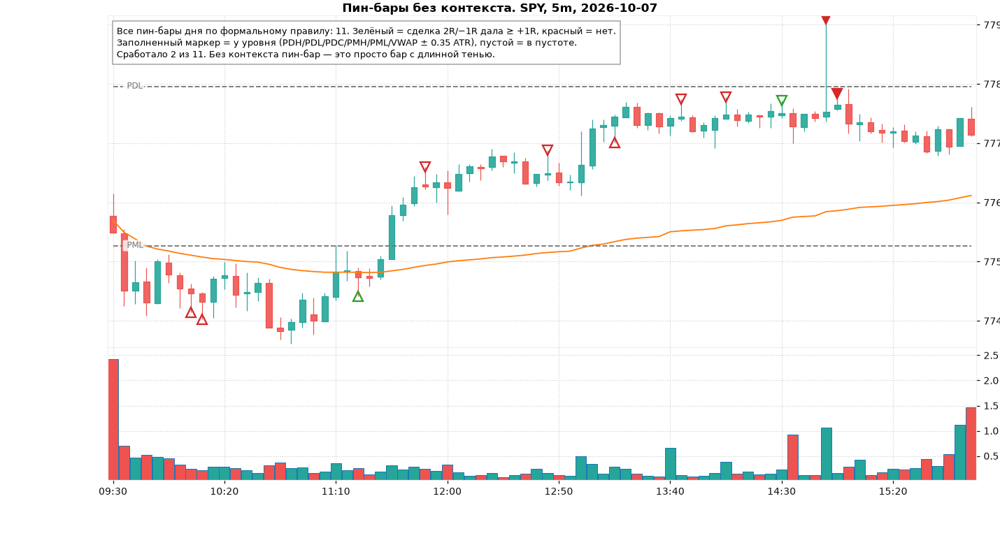
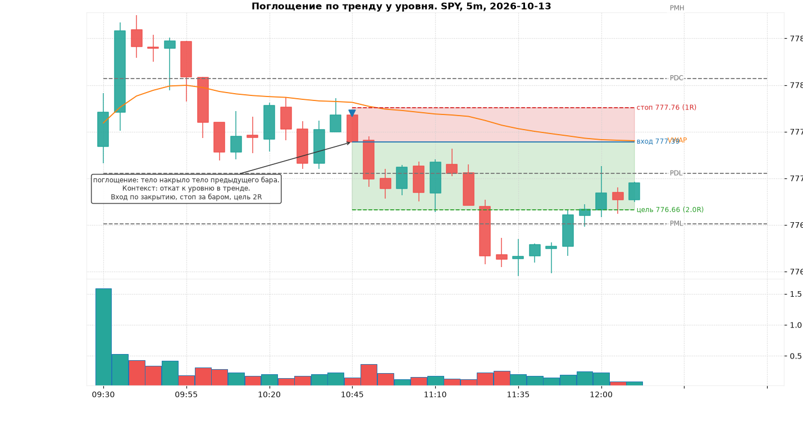
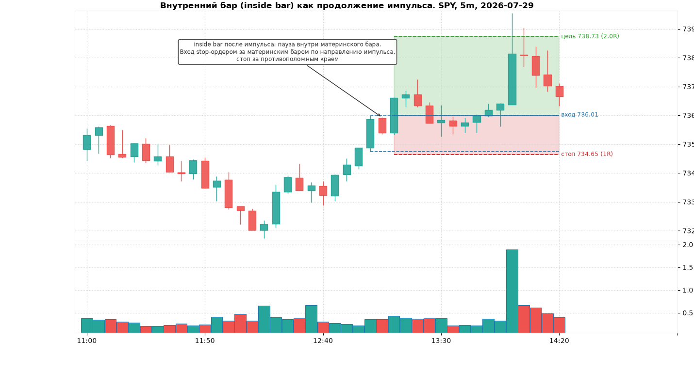
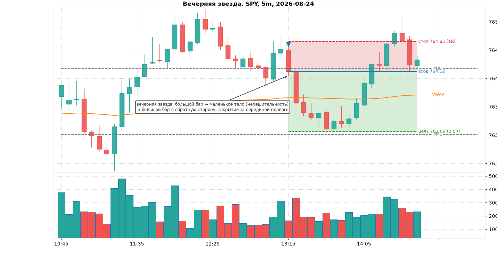
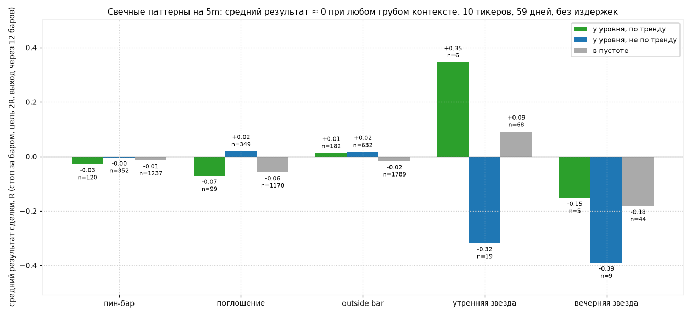

# Модуль 5. Свечные паттерны: где они работают, а где это шум

> Что здесь: пин-бар, поглощение, доджи, внутренний и внешний бар, утренняя и вечерняя звезда. Формальные определения (те же, что в коде тренажёра), контекст, в котором паттерн имеет смысл, и честная проверка на данных: сама по себе форма свечи преимущества не даёт.

## 5.0. Главное до всех паттернов

Свечной паттерн — это запись того, что произошло за один-три бара: кто-то продавил цену, кто-то её вернул. Это **информация о последних 5–15 минутах**, не больше. Паттерн может быть полезен в двух ролях:

1. **Триггер тайминга.** У вас уже есть причина для сделки (уровень из модуля 2, режим дня из модуля 3, сетап из модуля 7). Паттерн говорит, *когда* нажать кнопку и *где* стоп.
2. **Свидетельство реакции.** У уровня появился пин-бар — значит, уровень кто-то защищает. Нет реакции — уровень, возможно, не работает.

В роли «самостоятельный сигнал» паттерн не работает. Это не мнение, это измерено ниже на 7000+ паттернах.

Все пороги ниже в ATR(14), как в коде `backend/features/candles.py`. Паттерн считается только на **закрытом** баре.

## 5.1. Пин-бар (pin bar, hammer / shooting star)

Определение: диапазон бара ≥ 0.6 ATR; тело ≤ 1/3 диапазона; одна тень ≥ 60% диапазона, противоположная ≤ 20%.

- Длинная **нижняя** тень = бычий пин-бар (молот, hammer): цену продавили вниз, покупатели вернули её к открытию. Отказ (rejection) от низких цен.
- Длинная **верхняя** тень = медвежий пин-бар (падающая звезда, shooting star).

Контекст, в котором он имеет смысл: тень **входит в уровень или зону** (PDH/PDL, VWAP, свинг-уровень, зона спроса), а закрытие остаётся с «правильной» стороны. Тогда пин-бар = подтверждение, что уровень защищают.

Правила сделки (единые для всех разворотных паттернов курса):

- **Вход**: по закрытию бара паттерна или stop-ордером за его экстремумом в сторону сигнала (консервативнее: ждёт подтверждения следующим баром).
- **Стоп**: за противоположным концом тени + 0.1 ATR. Для пин-бара это за кончиком длинной тени.
- **Цель**: ближайший уровень, но не ближе 2R. Если до ближайшего уровня меньше 2R, сделки нет.

А вот как выглядят пин-бары **без** контекста. На одном дне по формальному правилу их нашлось больше десятка; маркер зелёный, если сделка со стопом за тенью и целью 2R дала хотя бы +1R:

## 5.2. Поглощение (engulfing)

Определение: тело текущего бара ≥ 0.5 ATR и накрывает тело предыдущего бара целиком; цвета противоположные; предыдущее тело не микроскопическое (≥ 0.1 ATR).

Смысл: за один бар рынок отменил предыдущий бар и пошёл дальше. Это агрессия одной стороны. Бычье поглощение после отката к уровню в аптренде — классический вход по тренду.

Где врёт: поглощение в середине диапазона, в обед, на низком объёме. И особенно — поглощение *против* сильного тренда («наконец-то разворот!»): в трендовый день таких «разворотов» будет пять, сработает один.

## 5.3. Доджи (doji)

Определение: тело ≤ 10% диапазона при диапазоне ≥ 0.6 ATR (крошечные доджи в обед не считаются).

Смысл: равновесие, нерешительность. Доджи **ничего не предсказывает сам по себе**: после него одинаково часто идут вверх и вниз. Польза — как часть звезды (ниже) и как знак паузы после импульса: следующий бар после доджи, пробивающий его экстремум, задаёт направление.

Не торгуйте доджи. Торгуйте то, что идёт после него, и только у уровня.

## 5.4. Внутренний и внешний бар (inside / outside bar)

**Внутренний бар**: high ниже и low выше, чем у предыдущего («материнского», mother bar). Сжатие после движения. Торгуется как **продолжение импульса**: если перед ним был импульс ≥ 1.5 ATR, вход stop-ордером за материнским баром по направлению импульса, стоп за противоположным краем материнского бара. Два-три внутренних бара подряд — ещё сильнее сжатие, но ждать больше трёх не стоит: это уже флэт.

**Внешний бар**: high выше и low ниже предыдущего, диапазон ≥ 0.6 ATR. Направление по цвету. Это волатильный бар, который «съел» обе стороны. У уровня с закрытием в сторону пробоя — сильный сигнал; в середине диапазона — просто широкий бар, после которого чаще откат.

## 5.5. Утренняя и вечерняя звезда (morning / evening star)

Три бара. Утренняя звезда: большой медвежий бар (тело ≥ 0.6 ATR) → маленькое тело (≤ 30% первого) не выше закрытия первого → большой бычий бар (≥ 0.5 ATR), закрывшийся выше середины первого. Вечерняя звезда зеркально.

Смысл: импульс → пауза → разворот с подтверждением. Это по сути пин-бар, растянутый на три бара, поэтому и контекст тот же: уровень или растянутость (±2σ от VWAP) плюс объём.

На 5m внутри дня звёзды редки (в данных курса ≈ 150 за 59 дней на 10 тикеров), и выборка слишком мала для выводов о них.

## 5.6. Честная проверка: контекст против формы

Для всех 10 тикеров и 59 дней на 5m найдены все паттерны по определениям выше и для каждого смоделирована стандартная сделка: вход по закрытию бара, стоп за экстремумом + 0.1 ATR, цель 2R, выход по касанию стопа/цели или по закрытию через 12 баров. Контекст: «у уровня» = экстремум бара в пределах 0.35 ATR от PDH/PDL/PDC/PMH/PML или VWAP; «по тренду» = направление паттерна совпадает с состоянием структуры (модуль 2).

| Паттерн | Контекст | n | средний результат, R | доля ≥ +1R |
|---|---|---|---|---|
| пин-бар | в пустоте | 1237 | −0.01 | 28% |
| пин-бар | у уровня | 472 | −0.01 | 27% |
| поглощение | в пустоте | 1170 | −0.06 | 24% |
| поглощение | у уровня | 448 | 0.00 | 25% |
| внешний бар | в пустоте | 1789 | −0.02 | 27% |
| внешний бар | у уровня | 814 | 0.02 | 25% |
| утренняя звезда | все | 93 | ~0 | 25% |
| вечерняя звезда | все | 58 | −0.2 | 20% |

Что это значит:

1. **Средний результат около нуля везде.** Свечной паттерн с механическими стопом и целью — это монетка минус издержки. Это совпадает с академическими результатами (Marshall, Young, Rose 2006: свечные паттерны на дневных данных США не дают прибыли; модуль 12).
2. **Грубый контекст («рядом с каким-нибудь уровнем») почти не помогает.** Уровней много, цена всегда «рядом» с каким-то из них. Контекст, который работает, намного уже: *конкретный* уровень, *первое* касание, *правильное* время дня, *объём*, *режим* дня. Это и есть сетап (модуль 7), и преимущество, если оно есть, живёт там, а не в форме свечи.
3. **Доля побед 25–28% при цели 2R** означает, что без фильтров математическое ожидание отрицательное (точка безубыточности для 2R:1R — 33%). Любой фильтр, поднимающий долю побед до 40%, делает систему прибыльной. Задача трейдера — найти этот фильтр и доказать его на статистике (тренажёр для этого и нужен).
4. **Примеры на картинках выше подобраны как лучшие случаи.** Так выглядит паттерн, когда он работает. Таблица показывает, как часто он работает.

## Типичные ошибки

1. Торговать паттерн без уровня. См. картинку с десятком пин-баров.
2. Считать паттерн на незакрытом баре.
3. Разворотный паттерн против сильного тренда «потому что уже слишком далеко зашло». Растянутость — не причина.
4. Стоп внутри тени пин-бара («чтобы меньше рисковать»). Стоп должен быть там, где идея сломана: за тенью.
5. Цель ближе 2R. При доле побед 30–40% это гарантированный минус.
6. Доджи как сигнал. Доджи — пауза, сигнал даёт следующий бар.
7. Поглощение в обед на объёме 0.5 от медианы. Нет участников — нет продолжения.
8. Искать паттерн на 1m. На 1m формально «паттерн» в каждом третьем баре.

## Чек-лист перед входом по свечному паттерну

- [ ] Бар закрыт.
- [ ] Паттерн соответствует формальному определению (размеры в ATR), а не «похож».
- [ ] Есть уровень или зона, в которую вошла тень/тело, и этот уровень из моего утреннего списка.
- [ ] Направление паттерна совпадает с режимом дня (VWAP, структура) или это первое касание сильного уровня во флэтовый день.
- [ ] Время: не первые 5 минут и не 11:30–14:00 без объёма.
- [ ] RVOL бара ≥ 1 (для разворотного у уровня желательно ≥ 1.5).
- [ ] Стоп за экстремумом + 0.1 ATR, расстояние до стопа ≥ 0.8 ATR и ≤ 2 ATR.
- [ ] До ближайшего уровня в сторону сделки ≥ 2R.

## Мини-тест

1. Дайте формальное определение бычьего пин-бара в терминах диапазона, тела и теней.
2. Чем молот отличается от падающей звезды и где каждый имеет смысл?
3. Бар с телом 0.05 ATR и диапазоном 0.3 ATR в 12:40. Это доджи?
4. Где ставится стоп для медвежьего поглощения и почему не ближе?
5. Что такое материнский бар и как торгуется внутренний бар после импульса?
6. Утренняя звезда: назовите три условия на три бара.
7. Какая доля побед нужна для безубыточности при цели 2R и стопе 1R? Какую долю показали паттерны в проверке?
8. Почему «рядом с уровнем» в проверке почти не улучшило результат?
9. Какая роль у свечного паттерна в курсе: источник преимущества или триггер? Обоснуйте данными.
10. Перед вами «идеальный» бычий пин-бар в 11:50 в середине дневного диапазона, RVOL 0.6. Решение?

### Ответы

1. Диапазон ≥ 0.6 ATR, тело ≤ 1/3 диапазона, нижняя тень ≥ 60% диапазона, верхняя ≤ 20%.
2. Молот — длинная нижняя тень (отказ от низких цен), имеет смысл у поддержки/VWAP снизу; падающая звезда — длинная верхняя тень, у сопротивления.
3. Нет: диапазон меньше 0.6 ATR, такие бары в обед — просто отсутствие сделок, не «нерешительность».
4. За high бара поглощения + 0.1 ATR. Ближе — внутри нормального шума, стоп будет выбит движением, которое не отменяет идею.
5. Бар, предшествующий внутреннему (внутренний полностью в его диапазоне). После импульса ≥ 1.5 ATR вход stop-ордером за материнским баром по направлению импульса, стоп за противоположным краем.
6. 1) большой медвежий бар (тело ≥ 0.6 ATR); 2) маленькое тело (≤ 30% первого) не выше закрытия первого; 3) большой бычий (≥ 0.5 ATR) с закрытием выше середины первого.
7. 33.3%. Паттерны показали 24–28%, то есть ниже безубыточности без дополнительных фильтров.
8. Уровней много, почти любой бар «рядом» с каким-то; грубый критерий ±0.35 ATR от шести уровней не отделяет значимую реакцию от случайной. Работает узкий контекст: конкретный уровень, первое касание, время, объём, режим.
9. Триггер. Средний результат механических сделок по паттернам ≈ 0 R при любом контексте; преимущество должно приходить от сетапа, а паттерн только определяет момент входа и место стопа.
10. Пропустить: середина диапазона (нет уровня), обеденное время, объём ниже медианы. Три пункта чек-листа не выполнены.
