# Модуль 6. Графические паттерны: флаги, треугольники, клинья, двойные вершины, голова-плечи, чашка, диапазоны

> Что здесь: формальные определения фигур (те же, что в коде тренажёра), правила входа, стопа и цели по высоте фигуры, и проверка на данных: с учебными правилами фигуры в среднем не зарабатывают. Как и свечи, фигура — способ *структурировать* вход, а не источник преимущества.

## 6.0. Общие правила для всех фигур

Фигура — это несколько свингов (модуль 2), образующих узнаваемую форму. Поскольку свинг подтверждается с задержкой, фигура «существует» только после того, как подтверждён её последний свинг. В коде курса фигура даёт событие на **баре подтверждения**: закрытие бара за границей фигуры.

Единые правила сделки (measured move, «отмеренное движение»):

| Элемент | Правило |
|---|---|
| **Вход** | закрытие бара за границей фигуры (консервативно) или stop-ордер на 0.05–0.1 ATR за границей (агрессивно) |
| **Стоп** | за противоположной границей фигуры + 0.1 ATR; для фигур продолжения — за минимумом консолидации |
| **Цель** | вход ± **высота фигуры** (для флага — высота флагштока) |
| **Фильтр** | R:R ≥ 1.5; объём на пробое RVOL ≥ 1.5 (модуль 3); направление пробоя согласовано с режимом дня (VWAP, структура) |

Если R:R по этим правилам < 1.5, сделки нет, даже если фигура «красивая». Если объёма на пробое нет, ждать ретест границы (модуль 7).

## 6.1. Фигуры продолжения: флаг и вымпел (flag, pennant)

Определение: **флагшток** (pole) — движение ≥ 2.5 ATR за ≤ 8 баров; затем **консолидация** 3–12 баров, диапазон которой ≤ 50% флагштока и откат ≤ 50% флагштока. Флаг — консолидация с параллельными границами (обычно слегка против импульса), вымпел — сужающаяся. Подтверждение — закрытие за верхней границей консолидации (бычий) или нижней (медвежий).

Смысл: после сильного импульса те, кто вошёл, фиксируют часть; продавцов не хватает, чтобы вернуть цену; затем вторая волна. Чем *меньше* откат (≤ 38%) и *короче* консолидация (3–6 баров), тем надёжнее.

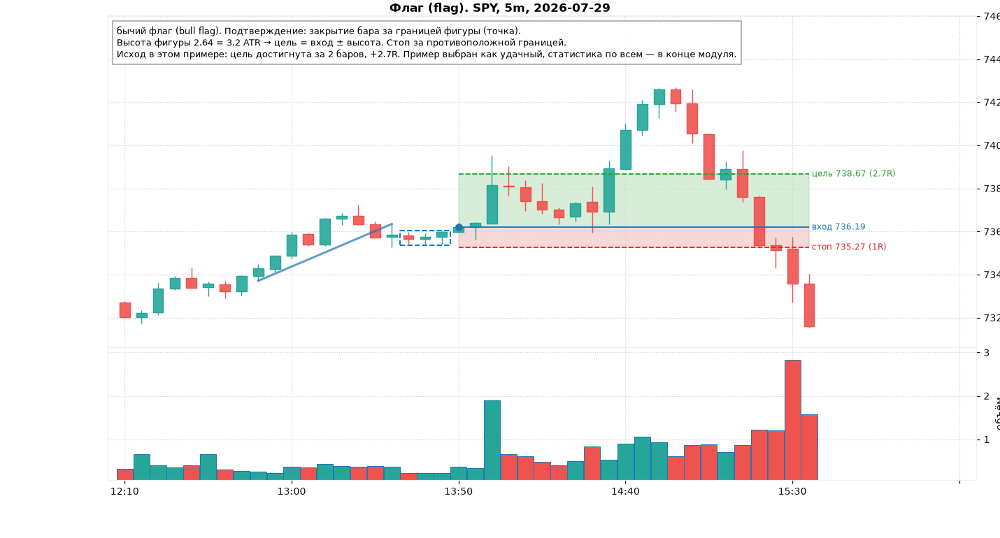

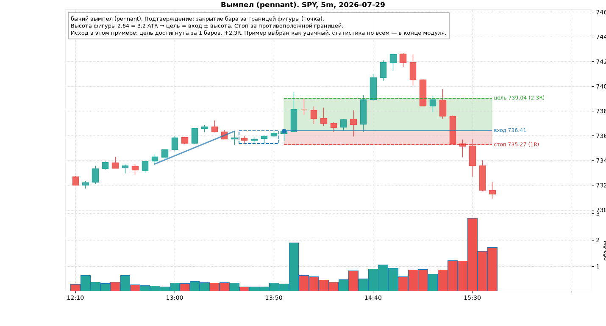

Цель = пробой + высота флагштока. Стоп = минимум консолидации − 0.1 ATR. Типичный R:R 2–3.

## 6.2. Треугольники (triangles)

Строятся по двум последним свинг-хаям (верхняя линия) и двум последним свинг-лоу (нижняя). Высота фигуры = расстояние между линиями в самой широкой части; требуется ≥ 1.5 ATR.

| Тип | Верхняя линия | Нижняя линия | Ожидаемый пробой |
|---|---|---|---|
| **восходящий** (ascending) | плоская (вершины в пределах 0.3 ATR) | растёт (HL) | вверх: покупатели поджимают к сопротивлению |
| **нисходящий** (descending) | падает (LH) | плоская | вниз |
| **симметричный** (symmetrical) | падает | растёт | в любую сторону, чаще по предшествующему тренду |

Подтверждение — закрытие за линией. Цель = пробой ± высота. Стоп — за противоположной линией в точке пробоя (для узкого треугольника это близко, R:R хороший).

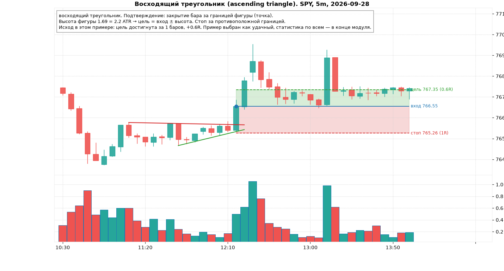

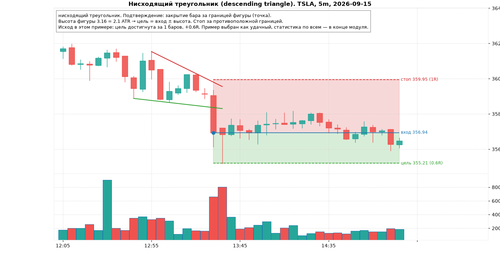

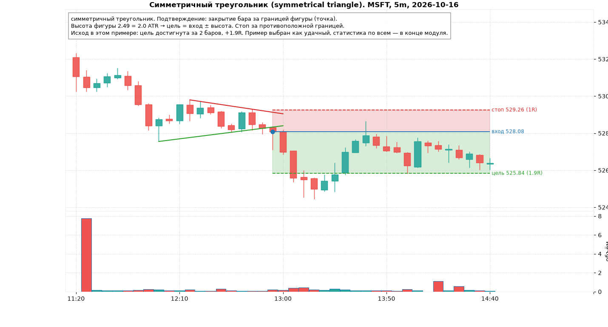

Правило из практики: пробой должен случиться в первых 2/3 треугольника (до схождения линий). Пробой у самой вершины, когда линии сошлись, — слабый, часто ложный.

## 6.3. Клинья (wedges)

Обе линии наклонены в одну сторону и сходятся.

- **Восходящий клин** (rising wedge): и хаи, и лоу растут, но лоу быстрее (импульс вверх выдыхается, каждый подъём меньше предыдущего). Медвежья фигура: пробой нижней линии.
- **Нисходящий клин** (falling wedge): обе линии падают, хаи быстрее. Бычья фигура.

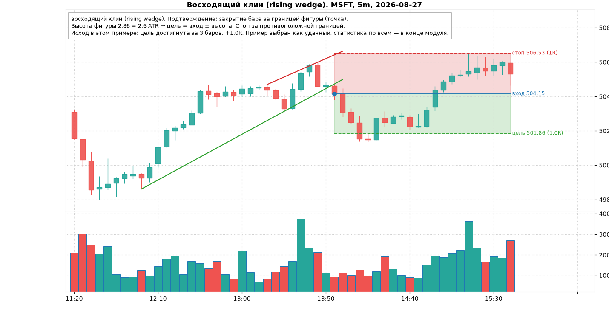

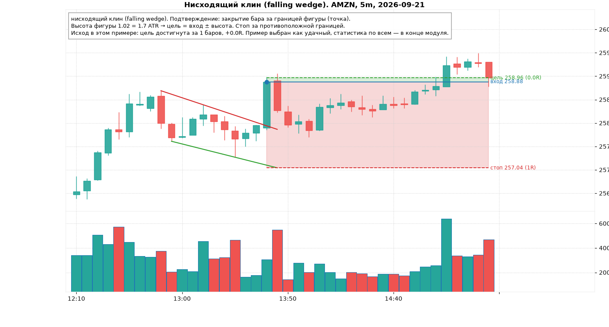

Клин против тренда — фигура разворота (восходящий клин на вершине аптренда); клин по тренду — фигура продолжения (нисходящий клин как откат в аптренде). Второе надёжнее.

## 6.4. Двойная вершина и двойное дно (double top / bottom)

Определение: два свинг-хая на одном уровне (±0.4 ATR), между ними свинг-лоу глубиной ≥ 1 ATR («линия шеи», neckline). Подтверждение — закрытие ниже линии шеи. Цель = линия шеи − высота (расстояние от вершин до шеи). Стоп — над вершинами + 0.1 ATR.

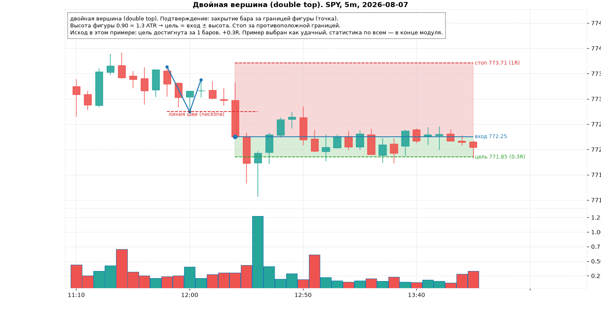

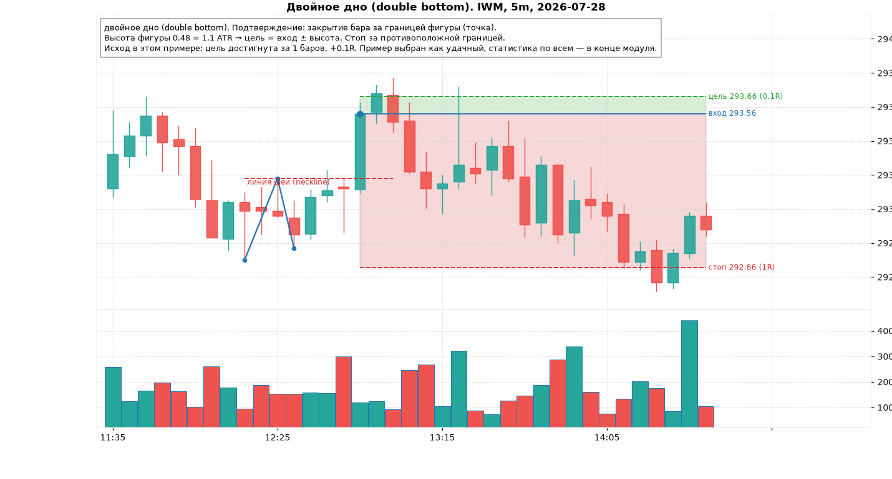

Проблема фигуры: ко времени подтверждения цена уже прошла всю высоту от вершины до шеи, а стоп стоит над вершинами, то есть **на расстоянии той же высоты**. R:R по учебным правилам ≈ 0.7 (медиана в данных курса). Поэтому двойную вершину с учебным стопом не торгуют. Рабочие варианты:

1. Вход на второй вершине при разворотной свече (модуль 5) со стопом за вершиной: R:R 2–3, но вход «против» ещё не подтверждённой фигуры.
2. Вход на ретесте линии шеи снизу после пробоя, стоп над ретестом: R:R ≥ 2.

## 6.5. Голова и плечи (head and shoulders)

Три свинг-хая: голова выше плеч на ≥ 0.8 ATR, плечи на одном уровне (±0.7 ATR). Линия шеи — через два лоу между плечами и головой (может быть наклонной). Подтверждение — закрытие под линией шеи. Цель = шея − (голова − шея). Стоп — над правым плечом. Перевёрнутая фигура (inverse H&S) — зеркально, бычья.

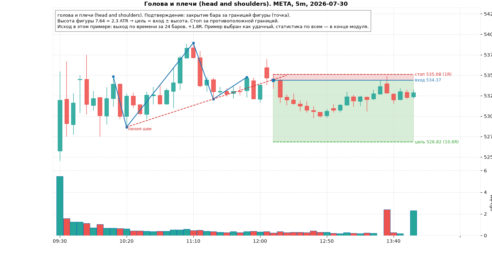

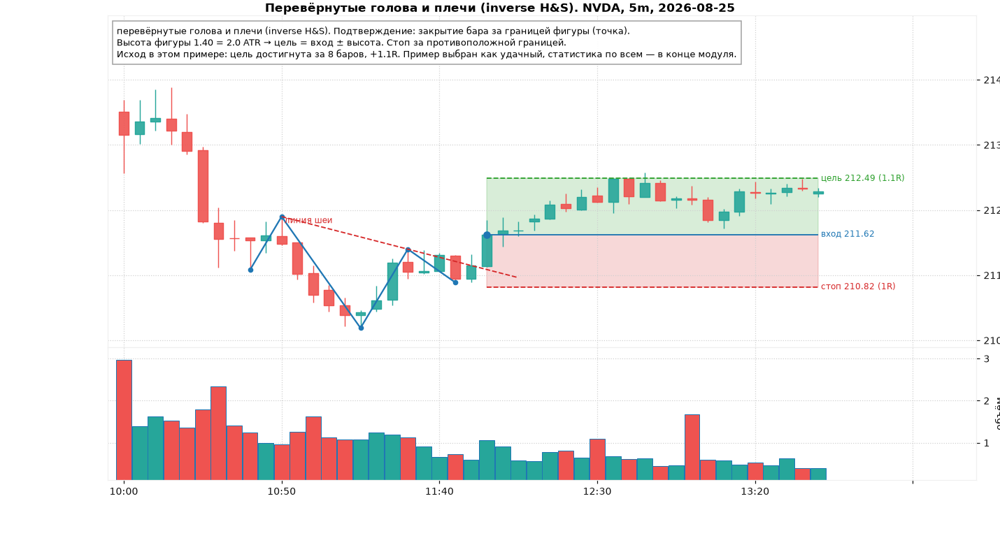

Внутри дня на 5m фигура встречается редко (≈ 30 за 59 дней на 10 тикеров) и в данных курса показала худший результат из всех (см. таблицу). Это не значит, что фигура «не работает» в принципе: Osler и Chang (1995) находили у неё прибыльность на валютном рынке. Это значит, что на 5m-данных с механическими правилами её преимущества не видно.

## 6.6. Чашка с ручкой (cup and handle)

Левый край → округлое дно (глубина 2–10 ATR) → правый край на уровне левого (±0.6 ATR) → ручка: откат ≤ 1/3 глубины на 2–12 баров → пробой края. Цель = край + глубина. Фигура Уильяма О'Нила, родом с **дневных** графиков: там она описывает многонедельное накопление. Внутри дня её формальные совпадения встречаются, но смысла (накопление крупным участником) за ними, как правило, нет.

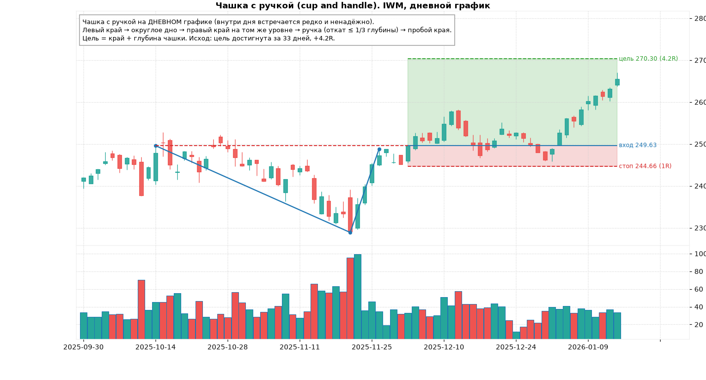

## 6.7. Диапазон (range, rectangle)

За последние 24 бара ≥ 2 касания верхней границы и ≥ 2 касания нижней (±0.3 ATR), высота 1.5–6 ATR. Два способа торговать:

1. **От границ** (fade): покупка у нижней границы при разворотной свече, стоп за границей, цель — противоположная граница (R:R ≥ 2 только если диапазон ≥ 3 × стоп). Работает во флэтовый день (модуль 3, 7).
2. **Пробой**: закрытие за границей + объём; цель = высота диапазона; стоп — середина диапазона. Работает, когда диапазон — пауза внутри тренда или сжатие перед новостью.

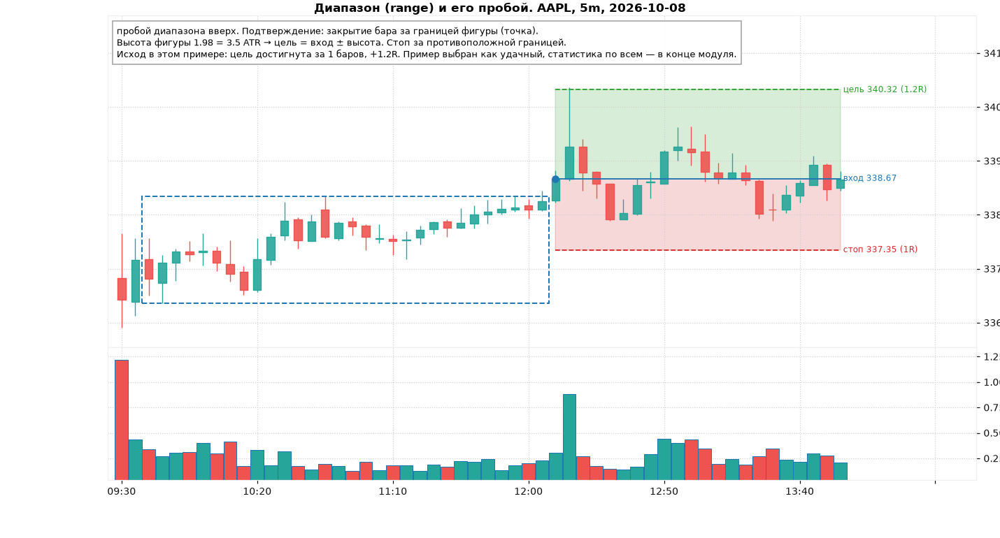

Главная ошибка — торговать пробой и отбой одного диапазона одновременно, без определения режима дня.

## 6.8. Честная проверка

Для всех 10 тикеров и 59 дней на 5m взяты все фигуры по определениям выше и смоделирована сделка по учебным правилам: вход по закрытию бара подтверждения, стоп и цель из фигуры, выход по касанию или через 24 бара (2 часа). Если стоп и цель задеты одним баром — считается стоп.

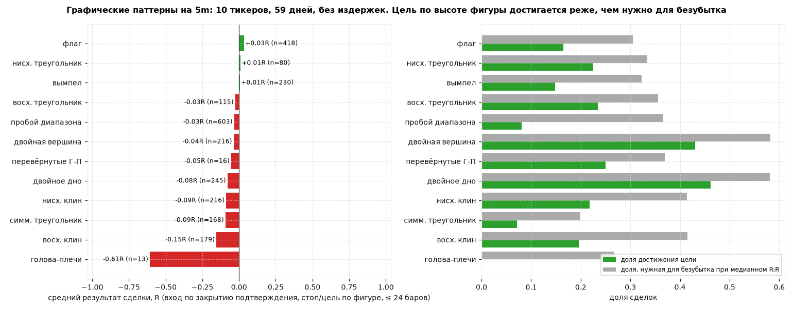

| Фигура | n | средний R | цель достигнута | стоп | медианный R:R | нужная доля побед |
|---|---|---|---|---|---|---|
| флаг | 418 | +0.03 | 17% | 46% | 2.3 | 30% |
| вымпел | 230 | +0.01 | 15% | 39% | 2.1 | 32% |
| нисходящий треугольник | 80 | +0.01 | 22% | 54% | 2.0 | 33% |
| восходящий треугольник | 115 | −0.03 | 23% | 50% | 1.8 | 36% |
| пробой диапазона | 603 | −0.03 | 8% | 20% | 1.7 | 37% |
| двойная вершина | 216 | −0.04 | 43% | 26% | 0.7 | 58% |
| двойное дно | 245 | −0.08 | 46% | 31% | 0.7 | 58% |
| нисходящий клин | 216 | −0.09 | 22% | 44% | 1.4 | 41% |
| симметричный треугольник | 168 | −0.09 | 7% | 60% | 4.1 | 20% |
| восходящий клин | 179 | −0.15 | 20% | 47% | 1.4 | 41% |
| голова и плечи | 13 | −0.61 | 0% | 69% | 2.8 | 27% |

Что из этого следует:

1. **Ни одна фигура с учебными правилами не даёт положительного ожидания** на этих данных. Лучший результат — флаг, +0.03R, что меньше спреда и комиссии.
2. **Цель «по высоте фигуры» достигается реже, чем нужно для безубытка**, почти везде. Цель по высоте — слишком амбициозна для интрадея: движение после пробоя обычно составляет 50–70% высоты. Практический вывод: фиксировать половину позиции на 0.5–0.6 высоты, остальное — по трейлинг-стопу.
3. **По времени дня**: фигуры, подтверждённые в 10:00–11:00, дали +0.06R, в 11:00–12:00 — −0.10R, после — около нуля. Первый час — единственное время, когда пробои фигур хоть как-то продолжаются.
4. **Как и со свечами, преимущество нужно искать в фильтрах**: объём на пробое, согласие с режимом дня, первый час, свежесть уровня. Проверять каждый фильтр нужно на статистике, а не «на глаз» (тренажёр, модуль 12).
5. Выборка на одном периоде; классификация фигур формальная и грубая; примеры на картинках подобраны как удачные.

## Типичные ошибки и ложные сигналы

1. Видеть фигуру до подтверждения последнего свинга (фигуры «перерисовываются»).
2. Торговать пробой без объёма и без ретеста.
3. Цель строго по высоте и ожидание её «до последнего»: половину фиксировать раньше.
4. Двойная вершина с учебным стопом над вершинами: R:R < 1.
5. Пробой треугольника у самой вершины (линии сошлись): ложный чаще, чем истинный.
6. Фигура против режима дня: медвежий флаг в день, когда цена весь день над VWAP.
7. Чашка с ручкой на 1m.
8. Рисовать линии так, чтобы они «подошли». Если линию нужно подгонять, фигуры нет.

## Чек-лист перед входом по фигуре

- [ ] Все свинги фигуры подтверждены, бар подтверждения закрыт за границей.
- [ ] Высота фигуры ≥ 1.5 ATR, посчитаны вход, стоп, цель; R:R ≥ 1.5.
- [ ] RVOL бара пробоя ≥ 1.5, иначе жду ретест границы.
- [ ] Направление согласовано с VWAP и структурой; для разворотных фигур есть CHoCH.
- [ ] Время: первый час предпочтительно; 11:30–14:00 — только с объёмом.
- [ ] План выхода: 50% на 0.5–0.6 высоты, остальное по трейлингу за свингами.
- [ ] Стоп выставлен вместе со входом (bracket).

## Мини-тест

1. Формальное определение флагштока и консолидации бычьего флага.
2. Чем вымпел отличается от флага?
3. Какой треугольник пробивается вверх по определению и почему?
4. Восходящий клин — бычья или медвежья фигура? Почему?
5. Где линия шеи двойной вершины и почему учебный стоп даёт плохой R:R?
6. Как считается цель для головы и плеч?
7. На каком таймфрейме имеет смысл чашка с ручкой и почему?
8. Два способа торговать диапазон и в какой тип дня каждый уместен?
9. Какая фигура показала лучший средний результат в проверке и сколько это в R?
10. Почему в курсе рекомендуется фиксировать половину позиции раньше цели по высоте?

### Ответы

1. Флагшток: движение ≥ 2.5 ATR за ≤ 8 баров. Консолидация: 3–12 баров, диапазон ≤ 50% флагштока, откат ≤ 50% флагштока. Подтверждение — закрытие выше верхней границы консолидации.
2. У вымпела границы консолидации сходятся (сужение), у флага параллельны.
3. Восходящий: плоская верхняя линия и растущие минимумы — покупатели каждый раз возвращаются выше, сопротивление «поджимается».
4. Медвежья: минимумы растут быстрее максимумов, каждый подъём меньше, импульс выдыхается; пробой нижней линии.
5. Через свинг-лоу между вершинами. К подтверждению цена уже прошла всю высоту вниз, а стоп над вершинами на ту же высоту вверх: R:R ≈ 0.7.
6. Цель = линия шеи в точке пробоя − (голова − линия шеи под головой).
7. На дневном: фигура описывает многонедельное накопление; на 5m формальные совпадения без смысла.
8. От границ (разворотная свеча у границы, цель — противоположная граница) во флэтовый день; пробой с объёмом (цель — высота) когда диапазон — пауза в тренде или перед событием.
9. Флаг: +0.03R, то есть практически ноль.
10. Цель по высоте достигается в 15–25% случаев; типичное движение после пробоя 50–70% высоты. Частичная фиксация повышает долю прибыльных сделок и ожидание.
