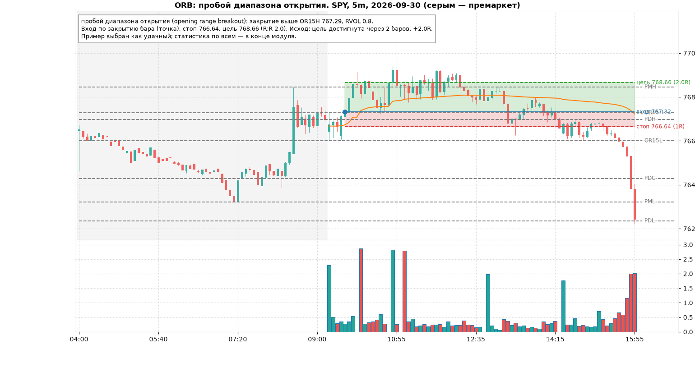
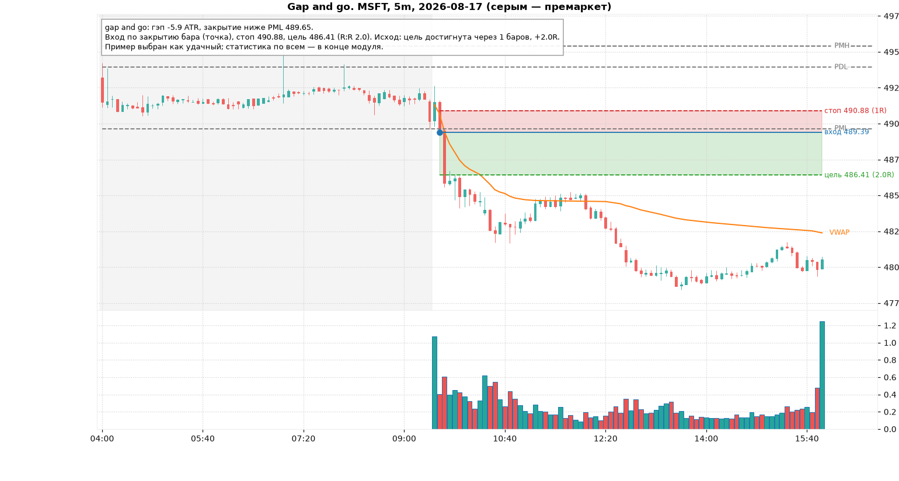
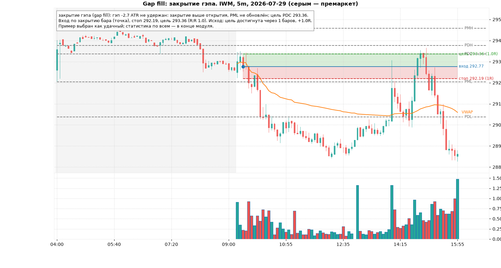
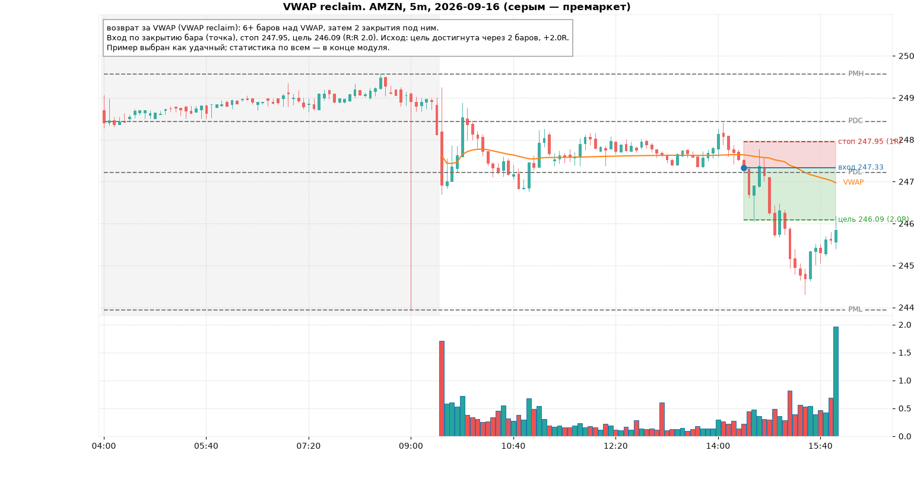
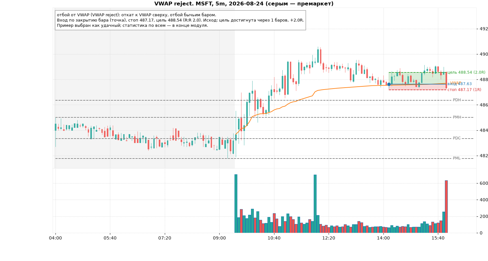
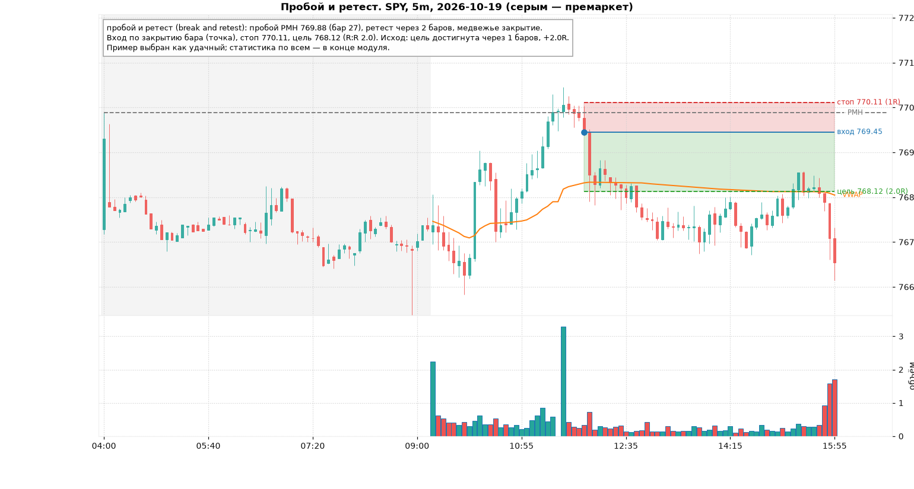
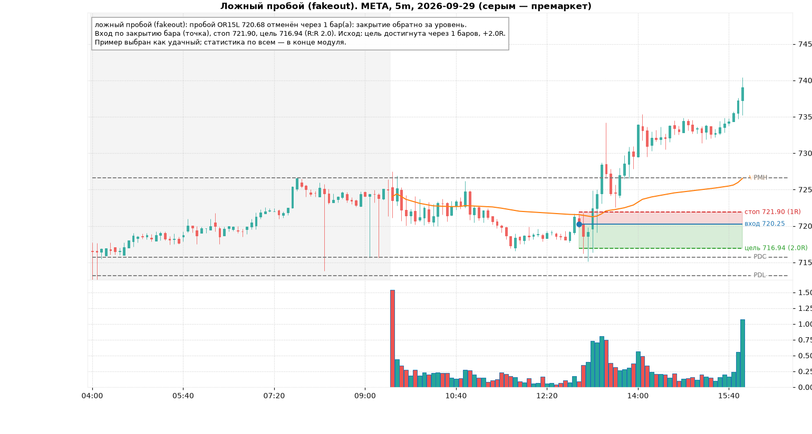
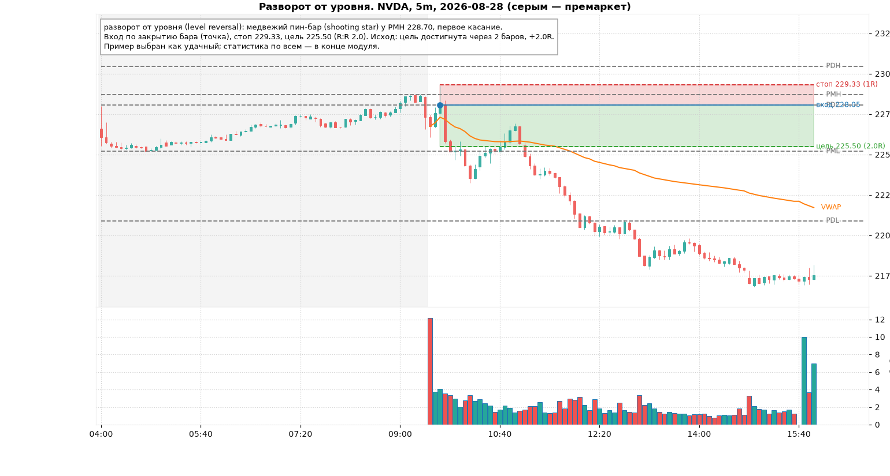
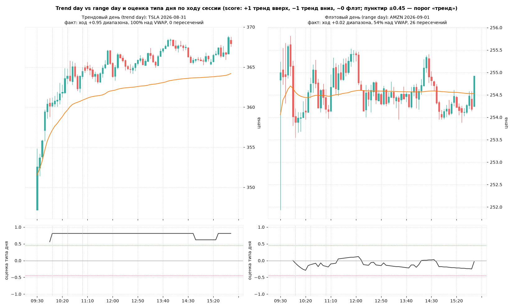
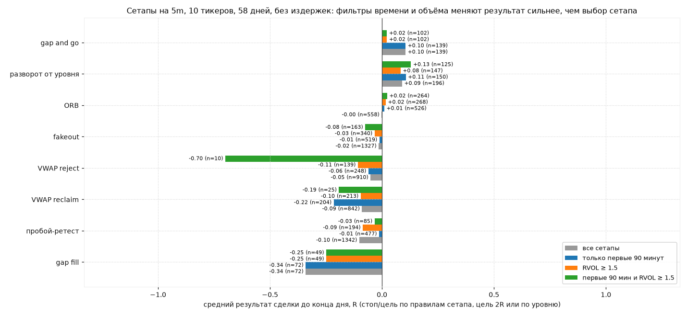

# Модуль 7. Дей-трейдинг сетапы

> Что здесь: восемь сетапов, которые составляют 90% того, что реально торгуют внутри дня, с формальными правилами (вход, стоп, цель, фильтры) и проверкой каждого на данных. Плюс главный навык первого часа: отличить трендовый день от флэтового.
>
> Сетап (setup) — это повторяющаяся ситуация с заранее известными правилами. Не «мне кажется, пойдёт вверх», а «условия A, B, C выполнены, вход здесь, стоп здесь, цель здесь, иначе сделки нет».

Все правила ниже реализованы в `trainer/backend/features/setups.py` и используются в тренажёре (режим «по теме» и разбор раунда). Обозначения: PDH/PDL/PDC — максимум/минимум/закрытие прошлого дня, PMH/PML — максимум/минимум премаркета, ORH/ORL — границы диапазона открытия, ATR — ATR(14) на рабочем таймфрейме (модуль 4), RVOL — относительный объём (модуль 3).

## 7.1. ORB: пробой диапазона открытия (opening range breakout)

Идея: первые 15 минут (варианты: 5 или 30) — это аукцион, на котором ночные ордера встречаются с дневными. Его границы — первые значимые уровни дня. Выход из диапазона с объёмом задаёт направление дня.

| Элемент | Правило |
|---|---|
| Диапазон | high/low первых 15 минут (OR15H / OR15L) |
| Вход | первое закрытие бара выше OR15H (лонг) / ниже OR15L (шорт) в первые 2 часа |
| Стоп | середина диапазона, если OR ≤ 2 ATR; иначе противоположная граница; но не ближе 0.5 ATR от входа |
| Цель | max(высота OR, 2R) |
| Фильтры | RVOL бара пробоя ≥ 1.5; пробой в сторону гэпа или в сторону положения цены относительно VWAP; не торгуется, если OR > 3 ATR (слишком широкий, стоп далеко) или < 0.7 ATR (слишком узкий, шум) |

Что говорит проверка: ORB по этим правилам — около нуля (+0.00R, 558 сделок), при этом доля прибыльных 46% — самая высокая среди сетапов, но средний выигрыш маленький: цель 2R достигается лишь в 8% случаев, большинство сделок закрывается в конце дня около входа. Вывод: ORB как сигнал направления работает лучше, чем ORB как сделка с фиксированной целью. Практики используют его с трейлинг-стопом за свингами (модуль 2) и фиксацией половины на 1R.

## 7.2. Gap and go / gap fill

Гэп (gap) — открытие дня далеко от вчерашнего закрытия: в курсе значимым считается |open − PDC| ≥ 1.5 ATR. Гэп означает, что ночью появилась информация, и первая задача дня — понять, принимает ли рынок новые цены.

**Gap and go**: рынок принимает. Условие: в первые 45 минут закрытие выше PMH (при гэпе вверх) → лонг, стоп под открытием дня (или под минимумом последних 3 баров, что ниже, но не дальше 1.5 ATR), цель max(2R, +0.5 величины гэпа). Зеркально для гэпа вниз.

**Gap fill**: рынок отвергает. Условие: в первые 45 минут закрытие ниже открытия дня на ≥ 0.5 ATR, при этом PMH не обновлён → шорт, стоп над максимумом дня, цель PDC (закрытие гэпа). Сделка только если R:R ≥ 1.

Проверка: gap and go +0.10R (139 сделок) — один из двух сетапов с положительным результатом, но с фильтром RVOL ≥ 1.5 эффект сжимается до +0.02R: он хрупкий. Gap fill −0.34R (72 сделки, цель достигнута в 19%) — худший сетап таблицы. Почему: при существенном гэпе на ликвидных именах «полное закрытие гэпа в тот же день» случается реже, чем кажется, а стоп над максимумом дня близко. Рабочая версия gap fill — частичная цель (половина гэпа или VWAP), а не PDC.

## 7.3. VWAP reclaim / reject

**Reclaim** (возврат): цена ≥ 6 баров под VWAP, затем два закрытия подряд над ним → лонг, стоп под минимумом последних 3 баров и под VWAP − 0.2 ATR, цель 2R. Логика: продавцы потеряли контроль, средний покупатель дня снова в плюсе.

**Reject** (отбой): цена под VWAP, бар касается VWAP снизу (high ≥ VWAP − 0.1 ATR) и закрывается ниже медвежьим баром с верхней тенью ≥ 0.3 ATR → шорт, стоп над баром и над VWAP + 0.15 ATR, цель 2R. Зеркально — отбой от VWAP сверху в аптренде (это и есть «откат к VWAP» из модуля 3).

Проверка: оба в минусе (reclaim −0.09R, reject −0.05R), а reclaim в первые 90 минут — −0.22R. Причина понятна из модуля 3: в первый час VWAP ещё «молодой» и цена пересекает его часто; reclaim в 10:00 — это чаще шум, чем смена контроля. Рабочий фильтр для reclaim: после 10:30, и день не флэтовый (≤ 2 пересечений VWAP в час). Reject работает лучше как откат по тренду (с режимом дня), чем как контртрендовый отбой.

## 7.4. Пробой и ретест (break and retest)

Самая логичная сделка: уровень пробит закрытием, цена возвращается к нему, уровень меняет роль (сопротивление становится поддержкой), и вход происходит с коротким стопом.

| Элемент | Правило |
|---|---|
| Уровни | PDH, PDL, PDC, PMH, PML, OR15H, OR15L |
| Пробой | закрытие за уровнем |
| Ретест | через 2–15 баров low касается уровня (≤ 0.3 ATR над ним), бар бычий и закрывается выше уровня; между пробоем и ретестом цена не уходила обратно за уровень больше чем на 0.2 ATR |
| Вход | закрытие бара ретеста |
| Стоп | под минимумом ретеста и под уровнем − 0.1 ATR |
| Цель | 2R (или следующий уровень, если он дальше) |

Проверка: в среднем −0.10R (1342 сделки); в первые 90 минут — около нуля (−0.01R), фильтр объёма не помогает (−0.09R). Ретесты в середине дня — ловушки: цена возвращается к уровню не для «подтверждения», а потому что пробой был пустым. Ретест в первый час — честная ничья, и преимущество нужно добирать другими фильтрами (тип дня, конфлюэнция уровней).

## 7.5. Ложный пробой (fakeout, failed breakout)

Зеркало предыдущего: пробой закрытием, но в течение ≤ 3 баров закрытие обратно за уровень на ≥ 0.2 ATR. Те, кто купил пробой, в ловушке; их стопы — топливо для движения в обратную сторону.

Вход: закрытие бара, вернувшего цену за уровень. Стоп: за экстремумом ложного пробоя + 0.1 ATR. Цель: 2R или противоположная сторона диапазона.

Проверка: −0.02R (1327 сделок), фильтры времени и объёма ничего не меняют (−0.01R и −0.03R). Нейтрально. Fakeout — единственный сетап, который *лучше* работает в середине дня во флэт, потому что это флэтовая сделка по определению: в трендовый день «ложные» пробои оказываются истинными.

## 7.6. Разворот от уровня (level reversal)

Первое касание ключевого уровня дня (PDH/PDL/PDC/PMH/PML ± 0.3 ATR) разворотной свечой из модуля 5 (пин-бар, поглощение, звезда) в сторону от уровня, закрытие по внутренней стороне. Вход по закрытию, стоп за экстремумом свечи + 0.1 ATR, цель 2R или следующий уровень.

Проверка: +0.09R (196 сделок), в первый час +0.11R, с объёмом +0.08R, с обоими фильтрами +0.13R. Второй сетап с положительным ожиданием, и единственный, где результат держится при всех фильтрах. Обратите внимание на отличие от модуля 5: там те же свечи «у какого-нибудь уровня» давали ноль. Разница — *первое* касание *ключевого* уровня (пять конкретных цен, а не любой свинг). Контекст решает.

## 7.7. Trend day vs range day: как отличить в первый час

Самое дорогое решение дня, потому что в трендовый день работают сетапы продолжения (ORB, gap and go, откаты к VWAP/EMA20, пробой-ретест), а во флэтовый — сетапы разворота (fakeout, отбой от границ диапазона, возврат к VWAP от ±2σ). Торговать флэтовые сетапы в трендовый день — значит шортить каждый новый максимум.

Признаки трендового дня к 10:30:

1. **Гэп** ≥ 0.3 диапазона прошлого дня, который не закрывается в первые 30 минут.
2. **OR15 пробит и удержан**: после пробоя цена не возвращается в диапазон.
3. **Одна сторона VWAP**: ≥ 80% закрытий 5m с одной стороны, ≤ 2 пересечений VWAP в час.
4. **Стек EMA9 > EMA20 > VWAP** (или зеркально) к 10:30.
5. **Откаты короткие**: не глубже 0.5 ATR, 2–4 бара.

Признаки флэтового дня: открытие внутри вчерашней value area (модуль 3), ≥ 3 пересечений VWAP в час, OR15 пробит в обе стороны, диапазон первого часа < 40% диапазона прошлого дня.

Формально в коде: оценка `score ∈ [−1, 1]` = взвешенная сумма доли закрытий над VWAP, удержания OR15, стека EMA и гэпа, умноженная на «чистоту» (штраф за пересечения VWAP). |score| ≥ 0.45 при ≤ 2 пересечениях в час = «трендовый день».

Проверка (580 дней, 10 тикеров): фактически трендовых дней (ход ≥ 60% диапазона, ≥ 80% времени с одной стороны VWAP) — 28%, флэтовых (ход ≤ 30% диапазона, ≥ 6 пересечений) — 20%, остальное смешанные.

| Время оценки | доля дней, названных «тренд» | точность «тренд» (факт = тренд) | точность с направлением | базовая доля трендовых |
|---|---|---|---|---|
| 10:00 | 28% | 37% | 36% | 28% |
| 10:30 | 38% | 42% | 41% | 28% |
| 11:00 | 40% | 43% | 43% | 28% |
| 11:30 | 40% | 47% | 47% | 28% |

Оценка лучше случайной (42% против 28% в 10:30), но далеко не надёжна: в 6 случаях из 10 день, названный трендовым, таковым не станет. Практический вывод: тип дня — это **гипотеза с постоянным пересмотром**, а не решение. Правило курса: торговать сетапы продолжения, пока оценка держится; первое возвращение цены за VWAP с закрытием — повод остановиться и пересмотреть.

## 7.8. Сводная проверка сетапов

Для всех 10 тикеров и 58 дней на 5m найдены все сетапы по правилам выше, смоделирована сделка (вход по закрытию бара сигнала, стоп и цель по правилам, выход по касанию или в конце дня; стоп и цель в одном баре = стоп). Без спреда и комиссий.

| Сетап | n | средний R | доля прибыльных | цель | стоп | первые 90 мин, R | RVOL ≥ 1.5, R | по тренду дня (ex post), R |
|---|---|---|---|---|---|---|---|---|
| gap and go | 139 | **+0.10** | 36% | 34% | 63% | +0.10 | +0.02 | +1.52 (n=30) |
| разворот от уровня | 196 | **+0.09** | 44% | 23% | 53% | +0.11 | +0.08 | +1.11 (n=38) |
| ORB | 558 | 0.00 | 46% | 8% | 29% | +0.01 | +0.02 | +0.87 (n=153) |
| fakeout | 1327 | −0.02 | 36% | 25% | 58% | −0.01 | −0.03 | +0.90 (n=119) |
| VWAP reject | 910 | −0.05 | 32% | 29% | 64% | −0.06 | −0.11 | +0.58 (n=133) |
| VWAP reclaim | 842 | −0.09 | 36% | 17% | 51% | −0.22 | −0.10 | +0.99 (n=40) |
| пробой-ретест | 1342 | −0.10 | 34% | 22% | 61% | −0.01 | −0.09 | +0.72 (n=187) |
| gap fill | 72 | −0.34 | 28% | 19% | 67% | −0.34 | −0.25 | +0.70 (n=10) |

По времени входа (все сетапы вместе):

| Время входа | n | средний R | доля прибыльных |
|---|---|---|---|
| 09:30–10:00 | 963 | **+0.06** | 42% |
| 10:00–10:30 | 752 | −0.08 | 36% |
| 10:30–11:00 | 620 | −0.08 | 35% |
| 11:00–12:00 | 998 | **−0.14** | 31% |
| 12:00–13:30 | 966 | −0.04 | 36% |
| 13:30–16:00 | 1087 | −0.04 | 37% |

Что из этого следует:

1. **Два сетапа с положительным ожиданием**: gap and go и разворот от уровня. Оба — про первый час и про ключевые уровни. Эффект +0.1R — маленький, сравнимый с издержками на не самых ликвидных именах. У разворота от уровня он держится при всех фильтрах, у gap and go с фильтром объёма почти исчезает; то есть первый результат надёжнее второго.
2. **Время важнее сетапа.** Первые 30 минут: +0.06R; 11:00–12:00: −0.14R. Разброс по времени (0.2R) больше, чем разброс между сетапами (кроме gap fill).
3. **Колонка «по тренду дня»** — это заглядывание в будущее: тип дня известен только вечером. +0.9…1.5R в этой колонке показывают, *сколько стоит* умение определять тип дня в первый час. Оценка из 7.7 с точностью 42% даёт лишь часть этой суммы, но даже часть — больше, чем любой сетап сам по себе.
4. **Цель 2R достигается в 8–34% случаев.** При доле прибыльных 35–45% ожидание держится на выходах «в конце дня» около нуля. Это аргумент за частичную фиксацию на 1R и трейлинг, а не за фиксированную цель.
5. **Это один период в 58 дней.** Рынок в другом режиме даст другие цифры. Цель таблицы — показать *метод* проверки и порядок величин, а не выдать «рабочие» сетапы. Свой набор фильтров проверяется в тренажёре и журнале (модули 10, 12).

## Типичные ошибки

1. Торговать все сетапы весь день. Таблица по времени показывает, во что это обходится.
2. ORB на пробое без объёма и без направления гэпа.
3. VWAP reclaim в 09:50.
4. Gap fill с целью «полное закрытие гэпа».
5. Пробой-ретест в 12:30: это не ретест, это возврат.
6. Шортить ложные пробои в трендовый день: там они истинные.
7. Менять мнение о типе дня каждые 5 минут и торговать оба набора сетапов.
8. Входить без фиксированных правил стопа и цели, «по ощущению».

## Чек-лист сетапа (заполняется до входа)

- [ ] Название сетапа из списка выше и выполненные условия (все, не «почти»).
- [ ] Время: первый час предпочтительно; 11:00–13:30 — только разворотные сетапы во флэтовый день.
- [ ] Тип дня по оценке (тренд/флэт) и согласие сетапа с ним.
- [ ] RVOL бара сигнала ≥ 1.5 для пробойных сетапов.
- [ ] Вход, стоп, цель записаны; R:R ≥ 1.5 (кроме gap fill ≥ 1).
- [ ] Стоп ≥ 0.5 ATR и ≤ 2 ATR от входа.
- [ ] План частичной фиксации на 1R.

## Мини-тест

1. Правила ORB: где стоп, если OR15 = 1.2 ATR? А если 2.8 ATR?
2. Чем gap and go отличается от gap fill по условию входа?
3. Почему VWAP reclaim в первые 90 минут показал −0.22R?
4. Условия ретеста после пробоя: назовите три.
5. В какой тип дня fakeout работает, а в какой проигрывает?
6. Чем разворот от уровня из модуля 7 отличается от «пин-бар у уровня» из модуля 5, и почему результаты разные?
7. Назовите четыре признака трендового дня к 10:30.
8. Точность оценки «трендовый день» в 10:30 — 42%. Базовая доля трендовых дней — 28%. Это полезная оценка?
9. В какое время дня сетапы в среднем прибыльны и в какое убыточны сильнее всего?
10. Цель 2R достигается в 8–34% случаев. Что из этого следует для управления позицией?

### Ответы

1. При OR ≤ 2 ATR стоп — середина диапазона (но не ближе 0.5 ATR от входа); при 2.8 ATR — противоположная граница; при OR > 3 ATR сетап пропускается.
2. Gap and go — закрытие за экстремумом премаркета в сторону гэпа (принятие); gap fill — закрытие против гэпа на ≥ 0.5 ATR от открытия без обновления PMH/PML (отказ), цель PDC.
3. В первый час VWAP «молодой» и цена пересекает его часто; «возврат за VWAP» в это время — шум, а не смена контроля.
4. Через 2–15 баров после пробоя; касание уровня (≤ 0.3 ATR); бар в сторону пробоя закрывается за уровнем; между пробоем и ретестом цена не уходила обратно глубже 0.2 ATR.
5. Работает во флэтовый день (пробои границ отменяются); проигрывает в трендовый (пробои истинные).
6. Только пять ключевых уровней дня и только первое касание; в модуле 5 — любой из шести уровней в любой момент. Узкий контекст даёт +0.10R, широкий — ноль.
7. Гэп не закрывается; OR15 пробит и удержан; ≥ 80% закрытий с одной стороны VWAP и ≤ 2 пересечений в час; стек EMA9 > EMA20 > VWAP; короткие откаты.
8. Да, в полтора раза лучше базы, но в 58% случаев ошибается; использовать как гипотезу с пересмотром, а не как факт.
9. 09:30–10:00 (+0.06R); хуже всего 11:00–12:00 (−0.14R).
10. Частичная фиксация на 1R и трейлинг-стоп за свингами вместо ожидания полной цели.
