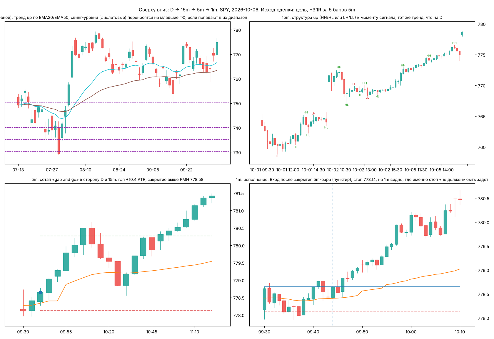
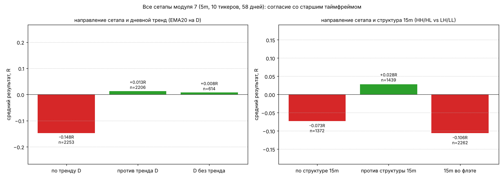

# Модуль 8. Мульти-таймфрейм анализ: как связать D, 15m, 5m и 1m

> Что здесь: порядок работы «сверху вниз» (top-down), что брать с каждого таймфрейма и что не брать, и честная проверка главного тезиса MTF-анализа («торгуй по старшему тренду»), которая в данных курса *не подтвердилась*.

## 8.1. Зачем несколько таймфреймов

Один таймфрейм показывает одну «частоту» рынка. На 5m сильный аптренд может быть откатом внутри дневного падения, а «важный уровень» на 1m — незаметной точкой на 15m. Смысл мульти-таймфреймового анализа (multi-timeframe, MTF) не в том, чтобы смотреть на четыре графика сразу, а в том, что **у каждого таймфрейма своя роль**:

| Таймфрейм | Роль | Что берём | Чего не берём |
|---|---|---|---|
| **D** (дневной) | контекст | тренд по EMA20/EMA50; свинг-уровни последних недель; вчерашние PDH/PDL/PDC; гэп | точек входа; «перекупленности» |
| **15m** | структура дня | HH/HL/LH/LL за 2–3 дня; слом структуры; ключевые зоны спроса/предложения; тип дня | точек входа |
| **5m** | сетап | сетапы модуля 7; VWAP; формальные паттерны; стоп и цель | дневного контекста (его там не видно) |
| **1m** | исполнение | точный момент входа после сигнала 5m; подтверждение отбоя у уровня; где «не должен» быть задет стоп | решений о направлении; «сетапов» (на 1m их по одному в каждом баре) |

Правило соотношения: соседние таймфреймы отличаются в 3–5 раз (1 → 5 → 15 → D ≈ 26 × 15m). Если они ближе, они показывают одно и то же; если дальше, связь теряется.

## 8.2. Порядок работы сверху вниз (top-down)

1. **D (вечером или до открытия)**: тренд (цена против EMA20, наклон EMA20), ближайшие свинг-уровни сверху и снизу (3–4 штуки в пределах ±6% от цены), вчерашние PDH/PDL/PDC. Эти уровни наносятся на все младшие графики и **не меняются в течение дня**.
2. **15m (до открытия и каждый час)**: структура последних 2–3 дней (последние HH/HL или LH/LL), есть ли слом; где свежие зоны спроса/предложения. Отсюда — гипотеза дня: «15m в аптренде, цена над вчерашним PDH, гэп вверх → ищу продолжение» или «15m сломал структуру вниз, цена под VWAP → ищу шорт от ретеста».
3. **5m (в течение дня)**: ждём, пока сетап из модуля 7 сформируется **у уровня, принесённого сверху**, в направлении гипотезы. Сетап без уровня со старшего ТФ — сделка второго сорта.
4. **1m (в момент сигнала)**: после закрытия сигнального 5m-бара смотрим 1m: не идёт ли уже откат, есть ли 1m-свеча подтверждения у уровня, где стоит стоп относительно 1m-свингов. 1m нужен, чтобы **не войти хуже**, а не чтобы найти вход.

На картинке: дневной аптренд, 15m в структуре HH/HL, на 5m gap and go в ту же сторону, на 1m — вход после закрытия 5m-бара со стопом ниже 1m-минимумов. Пример выбран как удачный.

## 8.3. Конфликт таймфреймов

Три типичных ситуации:

- **Все согласны** (D up, 15m up, 5m сетап на лонг): сделка «первого сорта». Можно брать полный размер позиции (модуль 9).
- **D против 15m** (D down, 15m up): это откат в даунтренде. Лонги на 5m — только к ближайшему дневному сопротивлению, половинный размер, цель ближе. Или ждать, пока 15m снова развернётся вниз (CHoCH), и торговать шорт.
- **15m против 5m** (15m down, 5m дал лонг-сетап): контртренд на младшем ТФ. По классике не торгуется. По данным ниже — не всё так просто.

## 8.4. Честная проверка: помогает ли «торговать по старшему тренду»

Тезис «входи только в сторону старшего таймфрейма» — самый распространённый совет в литературе. Проверим на сетапах модуля 7 (10 тикеров, 58 дней, 5m): для каждого сетапа определим, совпадает ли его направление с дневным трендом (цена выше EMA20 на D и EMA20 растёт 5 дней = up) и со структурой 15m (HH/HL = up, LH/LL = down) на момент сигнала.

| Условие | n | средний R | доля прибыльных |
|---|---|---|---|
| сетап **по** дневному тренду | 2253 | **−0.15** | 32% |
| сетап **против** дневного тренда | 2206 | +0.01 | 39% |
| D без тренда | 614 | +0.01 | 38% |
| сетап по структуре 15m | 1372 | −0.07 | 35% |
| сетап против структуры 15m | 1439 | +0.03 | 39% |
| 15m во флэте | 2262 | −0.11 | 35% |
| по D **и** по 15m одновременно | 619 | **−0.15** | 32% |

Это противоположно учебнику. Проверка, что это не ошибка кода: средний ход цены *после первого часа* в сторону дневного тренда в этой выборке = −0.22 ATR (t ≈ −2.7, 517 дней), и гэпы в среднем открывались против дневного тренда (−0.23 ATR, t ≈ −2.2). То есть в эти 58 дней внутри дня преобладал **откат против дневного тренда**: дни в аптренде по D чаще закрывались ниже открытия. Сетапы «по тренду» входили как раз в эти откаты.

Что из этого следует (и что не следует):

1. **Согласие со старшим ТФ — не автоматическое преимущество.** На горизонте нескольких часов есть известный эффект краткосрочного разворота (short-term reversal, модуль 12), и он может перевесить дневной моментум. Какой эффект сильнее — зависит от периода.
2. **Нельзя сделать вывод «торгуй против тренда».** 58 дней — один режим рынка. В трендовом режиме (например, 2023–2024 в индексах) результат, скорее всего, был бы обратным. Это именно то, что нужно проверять заново на своих данных каждые 2–3 месяца.
3. **Что в MTF-анализе устойчиво — это уровни, а не направление.** Разворот от ключевого уровня (модуль 7) остаётся лучшим сетапом независимо от тренда D, а дневные свинг-уровни и PDH/PDL — самые «видимые» уровни для всех участников. Старший ТФ в курсе используется прежде всего как **источник уровней и зон**, и лишь во вторую очередь как фильтр направления.
4. **Направление со старшего ТФ — гипотеза с весом**, а не правило: она влияет на размер позиции (полный / половинный), а не на разрешение торговать.

## 8.5. Практические правила связывания таймфреймов

1. Уровни наносятся сверху вниз и никогда не удаляются на младших ТФ.
2. Решение о направлении — на 15m (структура + VWAP + тип дня), пересмотр раз в час или при CHoCH.
3. Вход — только по закрытому 5m-бару с сетапом модуля 7 **у уровня** с D или 15m.
4. 1m — для исполнения: вход не хуже закрытия 5m-бара, стоп за 1m-свингом, если он даёт лучший R:R, чем правило сетапа, но не ближе 0.5 ATR(5m).
5. Конфликт D и 15m — половинный размер, цель — ближайший уровень старшего ТФ.
6. Если на 5m сетап «отличный», а уровня со старшего ТФ рядом нет — половинный размер или пропуск.
7. Результат сделок по признаку «согласие с D/15m» считается в журнале отдельно (модуль 10); решение о фильтре — по статистике, не по учебнику.

## Типичные ошибки

1. Торговать 1m-«сетапы» без 5m-контекста. На 1m паттерн виден в каждом третьем баре.
2. Переносить уровни снизу вверх («на 1m была поддержка»). Сверху вниз только.
3. Смотреть на D в середине дня и менять направление: D не меняется внутри дня, а 15m-структура — да.
4. Верить, что согласие трёх ТФ гарантирует сделку. Статистика выше.
5. Таймфреймы ближе чем в 3 раза (3m + 5m): дублирование.
6. Пропускать 1m при исполнении: вход на 0.3 ATR хуже закрытия 5m-бара на стопе в 1 ATR = −30% к R:R.

## Чек-лист

- [ ] На D: тренд (up/down/flat) и 3–4 ближайших свинг-уровня нанесены.
- [ ] На 15m: структура последних 2–3 дней, слом есть/нет, зоны спроса/предложения.
- [ ] Гипотеза дня записана одной строкой до открытия.
- [ ] На 5m сетап формируется у уровня с D/15m.
- [ ] 1m: вход после закрытия 5m-бара, стоп за 1m-свингом ≥ 0.5 ATR(5m).
- [ ] Размер позиции: полный при согласии D и 15m, половинный при конфликте.
- [ ] В журнале отмечено согласие с D и 15m для последующей проверки.

## Мини-тест

1. Какая роль у каждого из четырёх таймфреймов?
2. Почему 1m не используется для поиска сетапов?
3. Что переносится со старшего ТФ на младший, а что нет?
4. D down, 15m up. Что это и как торговать?
5. Что показала проверка тезиса «торгуй по дневному тренду» на данных курса?
6. Какой контрольный расчёт подтвердил, что это не ошибка кода?
7. Можно ли из этого сделать вывод «торгуй против тренда»? Почему?
8. Что в MTF-анализе устойчиво по данным курса?
9. На сколько ухудшает R:R вход на 0.3 ATR хуже закрытия сигнального бара при стопе 1 ATR?
10. Каково минимальное соотношение соседних таймфреймов и почему?

### Ответы

1. D — контекст и уровни; 15m — структура и гипотеза дня; 5m — сетап, стоп, цель; 1m — исполнение.
2. На 1m формальные паттерны встречаются почти в каждом баре; без 5m-контекста это шум. 1m уточняет вход, а не находит его.
3. Переносятся уровни, зоны и направление-гипотеза; не переносятся точки входа и «сигналы» младших ТФ наверх.
4. Откат в дневном даунтренде. Лонги только к ближайшему дневному сопротивлению, половинный размер; либо ждать CHoCH на 15m вниз и торговать шорт.
5. Сетапы по дневному тренду дали −0.15R, против — +0.01R; по структуре 15m −0.07R, против +0.03R. Тезис не подтвердился.
6. Средний ход цены после первого часа в сторону дневного тренда составил −0.22 ATR (t ≈ −2.7): в выборке внутри дня преобладал откат против D.
7. Нет: один режим рынка за 58 дней; в трендовом режиме результат может быть обратным. Проверять заново на своих данных.
8. Уровни со старших ТФ (разворот от ключевого уровня — лучший сетап независимо от тренда), а не направление.
9. Риск растёт с 1.0 до 1.3 ATR, цель уменьшается на 0.3 ATR: при цели 2 ATR R:R падает с 2.0 до 1.3, примерно на треть.
10. 3–5 раз. Ближе — дублирование информации, дальше — потеря связи между структурами.
