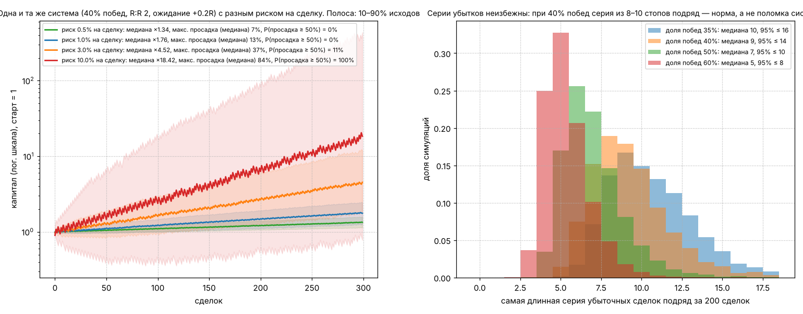
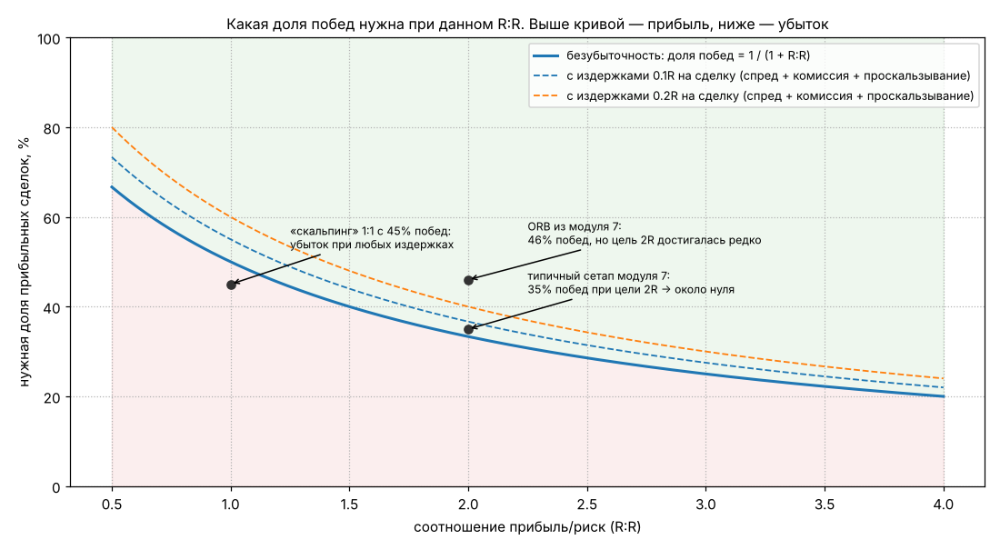
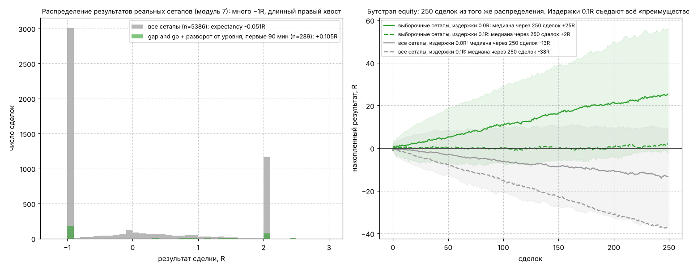

# Модуль 9. Риск-менеджмент: размер позиции, R:R, стоп, дневной лимит, expectancy

> Что здесь: единственная часть курса, где математика на вашей стороне без оговорок. Паттерны и сетапы дают (в лучшем случае) небольшое преимущество; риск-менеджмент решает, доживёте ли вы до момента, когда оно проявится.

## 9.1. Единица измерения: R

**R** — риск одной сделки в деньгах: расстояние от входа до стопа, умноженное на число акций.

> R = |вход − стоп| × количество акций

Все результаты считаются в R: сделка +2R принесла вдвое больше, чем в ней рисковали; −1R — стоп исполнился по плану; −1.4R — стоп проскользнул или вы его передвинули. Это делает сопоставимыми сделки на SPY по $770 и на AMD по $200, и, главное, убирает из головы доллары, которые мешают думать.

Правило курса: **R одинаков для всех сделок** в течение дня (или отличается только по заранее заданным «сортам» сетапов: полный R для первого сорта, 0.5R для второго).

## 9.2. Размер позиции (position sizing)

Единственная формула, которую нужно знать наизусть:

> количество акций = (капитал × риск на сделку в %) / |вход − стоп|

Пример: капитал $30 000, риск 0.5% = $150, вход 150.40, стоп 149.90 (0.50): 150 / 0.50 = 300 акций. Стоимость позиции $45 120, что больше капитала: это нормально на маржинальном счёте, лимит по позиции определяется стопом, а не ценой акции. Если брокер не даёт плечо, позиция ограничивается капиталом, и R уменьшается.

Следствия:

- Чем ближе стоп, тем больше позиция при том же R. Поэтому стоп ставится там, где идея сломана (модули 5–7), а не «поближе, чтобы меньше терять»: близкий стоп увеличивает позицию и частоту срабатываний одновременно.
- Стоп дальше 2 ATR → позиция слишком маленькая, чтобы движение к цели имело смысл относительно издержек. Такие сетапы пропускаются.
- Размер позиции считается **до** входа, не после.

## 9.3. Сколько рисковать на сделку

Одна и та же система (40% побед, R:R = 2, ожидание +0.2R на сделку) при разном риске на сделку:

| Риск на сделку | медиана капитала через 300 сделок | худшие 10% исходов | медианная макс. просадка | P(просадка ≥ 50%) |
|---|---|---|---|---|
| 0.5% | ×1.34 | ×1.14 | 7% | 0% |
| 1% | ×1.76 | ×1.27 | 13% | 0% |
| 3% | ×4.5 | ×1.86 | 37% | 11% |
| 10% | ×18 | ×0.78 | 84% | 100% |

При 10% риска медиана выглядит прекрасно, но **каждый** путь прошёл через просадку ≥ 50%, а каждый десятый закончился в убытке. Никто не выдерживает просадку 84% и не продолжает торговать по системе; значит, реальный результат при 10% — ноль. Это и есть риск разорения (risk of ruin): не формальное обнуление, а просадка, после которой трейдер ломается психологически или по правилам брокера.

Правила курса:

- **Новичок: 0.25–0.5% капитала на сделку** в течение первых 100 сделок (или всей фазы, пока статистика не показала положительное ожидание, модуль 12).
- **Опытный с подтверждённым преимуществом: 0.5–1%.** Больше 1% на дей-трейдинге — только при expectancy ≥ 0.3R на 300+ сделках, и всё равно это агрессивно.
- Половина правого графика выше: при 40% побед серия из **8–10 стопов подряд** за 200 сделок — норма. Риск на сделку должен быть таким, чтобы 10 стопов подряд были неприятны, но не фатальны: при 0.5% это −5%, при 3% это −26%.

## 9.4. Где ставить стоп

Стоп — цена, при которой **идея сделки опровергнута**. Не «сколько готов потерять», а «где я неправ».

| Сетап | Стоп |
|---|---|
| разворотная свеча у уровня | за экстремумом свечи + 0.1 ATR |
| пробой-ретест | за минимумом ретеста и за уровнем − 0.1 ATR |
| флаг/вымпел | за границей консолидации − 0.1 ATR |
| ORB | середина OR или противоположная граница |
| VWAP reclaim | под VWAP − 0.2 ATR и под минимумом последних 3 баров |
| любой | не ближе 0.5 ATR и не дальше 2 ATR от входа |

Три запрета:

1. **Стоп не двигается от цены** (дальше). Передвинуть стоп, чтобы «дать сделке шанс», — это открыть новую сделку с худшим R:R без сетапа.
2. **Стоп не ставится на круглом числе** и ровно на уровне: там стоят стопы всех. 0.1–0.2 ATR за уровнем.
3. **Стоп всегда в рынке** (stop-market, модуль 1), не «в голове». Мысленный стоп исполняется в 30% случаев.

Трейлинг (trailing stop): после достижения +1R стоп переносится в безубыток (вход + издержки); далее за каждый новый подтверждённый свинг (модуль 2) по направлению сделки — за предыдущий свинг. Это отдаёт часть прибыли на откатах, но даёт поучаствовать в длинном хвосте распределения (см. 9.6).

## 9.5. R:R и доля побед: безубыточность

Ожидание (expectancy) на сделку в R:

> E = p × RR − (1 − p) − c, где p — доля прибыльных, RR — средний выигрыш в R, c — издержки в R

Безубыточность (E = 0 без издержек): p = 1 / (1 + RR).

| R:R | нужная доля побед | с издержками 0.1R |
|---|---|---|
| 1:1 | 50% | 55% |
| 1.5:1 | 40% | 44% |
| 2:1 | 33% | 37% |
| 3:1 | 25% | 28% |

Почему в курсе везде цель ≥ 2R: при реалистичных 35–45% побед это единственная зона, где после издержек остаётся плюс. Скальпинг 1:1 требует 55%+ побед *после* издержек, которые на 1:1 съедают непропорционально много.

Издержки в R — не абстракция. Стоп 0.5 ATR на SPY в 12:30 ≈ $0.25; спред 1 цент на вход и выход + проскальзывание 1–2 цента = $0.03–0.04 = **0.07R**. На акции $20 со спредом 3 цента и стопом $0.15: издержки 0.4R. Такую акцию с таким стопом торговать нельзя ни с каким сетапом.

## 9.6. Expectancy на реальных сделках

Распределение результатов всех сетапов модуля 7 (5386 сделок) и выборочных (gap and go и разворот от уровня в первые 90 минут, 289 сделок):

| | n | expectancy | доля прибыльных |
|---|---|---|---|
| все сетапы | 5386 | −0.05R | 36% |
| выборочные | 289 | +0.11R | 39% |

Вид распределения важнее среднего: пик на −1R (стопы), размазанная масса около 0 (выходы в конце дня) и пик на +2R (цель). Вся прибыль системы — это 20–35% сделок, дошедших до цели; остальные в сумме около нуля или в минусе. Отсюда два следствия:

1. Нельзя резать прибыльные сделки ранним выходом «чтобы зафиксировать»: при фиксации на +0.5R пик на +2R исчезает, а пик на −1R остаётся. Частичная фиксация на 1R допустима, полный выход на +0.5R — нет.
2. На бутстрэпе (правый график) издержки 0.1R на сделку превращают +0.11R в +0.01R: **преимущество в 0.1R на сделку — это почти ноль после издержек**. Реальное преимущество должно быть ≥ 0.2–0.3R, иначе оно не переживёт спред, проскальзывание и ошибки исполнения.

## 9.7. Дневные и недельные лимиты

| Лимит | Правило курса | Зачем |
|---|---|---|
| макс. убыток за день | **−2R** (новичок) / −3R (опытный) | после двух стопов вероятность, что день «не ваш», выше, чем что вы «отыграетесь»; третья сделка в минусе — обычно revenge trading (модуль 11) |
| макс. число сделок в день | 3–4 | overtrading: сделки 4+ в день статистически хуже первых двух (журнал покажет это за месяц) |
| макс. убыток за неделю | −5R | неделя в −5R = остановка до понедельника и разбор журнала |
| макс. просадка от пика | −10R | пауза на неделю, торговля на минимальном размере после возврата |
| после 3 стопов подряд | размер 0.5R до двух прибыльных сделок | серии убытков нормальны, но торговать их на полном размере не нужно |

Лимиты работают только если они **автоматические**: выставлены у брокера (daily loss limit есть у большинства) или хотя бы записаны в плане до начала дня. Лимит, который решается «по ситуации», не лимит.

## 9.8. Корреляция и общий риск

Лонг SPY, лонг QQQ и лонг NVDA одновременно — это одна сделка с тройным риском, а не три сделки. Правило: суммарный открытый риск по коррелированным позициям ≤ 1.5R, по всем ≤ 3R. Для новичка — одна позиция за раз.

## Типичные ошибки

1. Считать размер позиции «в акциях» или «в долларах», а не от стопа.
2. Риск 2–5% на сделку, «потому что уверен».
3. Передвигать стоп дальше. Никогда.
4. Выход на +0.5R «пока в плюсе»: отрезан хвост, где живёт вся прибыль.
5. Торговать акции, где издержки > 0.1R.
6. Нет дневного лимита или лимит «в голове».
7. Три коррелированные позиции = «диверсификация».
8. Увеличивать размер после серии побед (и уменьшать после серии убытков) быстрее, чем это оправдывает статистика.

## Чек-лист (до входа и в конце дня)

- [ ] R на сегодня в долларах известен (0.25–0.5% для новичка).
- [ ] Количество акций = R / |вход − стоп|, посчитано до входа.
- [ ] Стоп там, где идея опровергнута; 0.5–2 ATR; не на круглом числе; stop-market в рынке.
- [ ] Цель ≥ 2R (gap fill ≥ 1R), издержки ≤ 0.1R.
- [ ] Дневной лимит −2R и лимит сделок выставлены у брокера.
- [ ] Открытый риск по коррелированным позициям ≤ 1.5R.
- [ ] В конце дня: результат в R записан, лимиты соблюдены (да/нет).

## Мини-тест

1. Капитал $20 000, риск 0.5%, вход 48.20, стоп 47.80. Сколько акций?
2. Что такое R и почему результаты считают в R, а не в долларах?
3. Система: 40% побед, R:R 2. Expectancy без издержек и с издержками 0.15R?
4. Какая доля побед нужна для безубытка при R:R 1.5 с издержками 0.1R?
5. Почему риск 3% на сделку опасен, если медиана капитала растёт в 4.5 раза?
6. Серия из 9 стопов подряд при 40% побед — это сломанная система?
7. Где стоп для разворотной свечи у уровня и почему не ближе?
8. После каких событий дня торговля останавливается по правилам курса?
9. Почему нельзя выходить на +0.5R «пока в плюсе»?
10. Лонг SPY + лонг QQQ по 1R каждая: какой это риск?

### Ответы

1. R = $100; |48.20 − 47.80| = 0.40; 100 / 0.40 = 250 акций.
2. R — риск сделки в деньгах (расстояние до стопа × количество). В R сопоставимы сделки на разных инструментах, и убирается эмоциональная привязка к долларам.
3. E = 0.4 × 2 − 0.6 = +0.2R; с издержками +0.05R.
4. p = (1 + 0.1) / (1 + 1.5) = 44%.
5. Медианная максимальная просадка 37%, у 11% путей просадка ≥ 50%; такие просадки ломают дисциплину, реальный исход хуже медианы симуляции.
6. Нет. При 40% побед за 200 сделок медиана самой длинной серии убытков = 9, 95-й процентиль = 14. Девять подряд — в пределах нормы; пересмотр системы — по expectancy на 100+ сделках, не по серии.
7. За экстремумом свечи + 0.1 ATR (но ≥ 0.5 ATR от входа). Ближе — внутри нормального шума, стоп выбивается движением, которое не опровергает идею.
8. −2R за день (новичок), 3–4 сделки, −5R за неделю, −10R от пика (пауза), 3 стопа подряд → половинный размер.
9. Прибыль системы — это сделки, дошедшие до цели 2R; ранний выход убирает их, а стопы по −1R остаются, и ожидание становится отрицательным.
10. ≈ 2R на одну идею (корреляция близка к 1); это нарушение лимита 1.5R на коррелированный риск.
