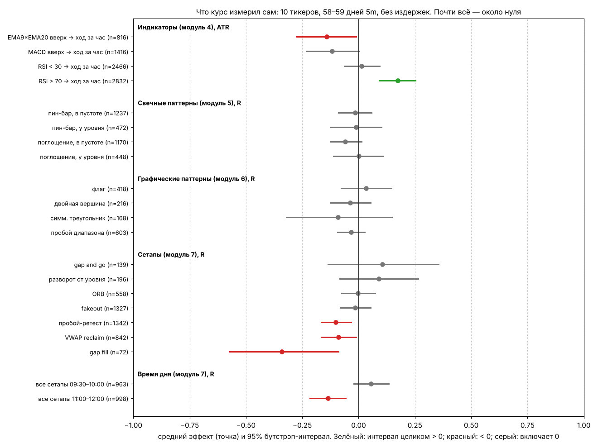

# Модуль 12. Честная часть: что говорят исследования

> Что здесь: что известно из рецензируемых исследований о прибыльности дей-трейдеров и технического анализа; какие эффекты имеют доказательства, какие нет; что курс измерил сам; и как проверять свои идеи так, чтобы не обмануть себя. Этот модуль стоит прочитать первым.

## 12.1. Сколько дей-трейдеров зарабатывают

Крупные исследования на полных данных бирж и брокеров (не опросы, не самоотчёты):

| Исследование | Данные | Результат |
|---|---|---|
| Barber, Lee, Liu, Odean (2004, рабочая версия; 2014, *Journal of Financial Markets*, «The cross-section of speculator skill») | все дей-трейдеры Тайваньской биржи, 1992–2006, сотни тысяч счетов | более 80% дей-трейдеров теряют деньги за полугодие; **менее 1%** стабильно зарабатывают после издержек из года в год. Небольшая группа с устойчивым навыком существует, но она крошечная, и её навык виден только по длинной истории |
| Chague, De-Losso, Giovannetti (2020, «Day Trading for a Living?») | все новые дей-трейдеры фьючерсами на индекс в Бразилии, 2013–2015, 19 646 человек | из тех, кто торговал 300+ дней, **97% потеряли деньги**; 1.1% заработали больше бразильской минимальной зарплаты; 0.5% — больше начальной зарплаты банковского клерка. Результаты *ухудшались* с опытом: обучение на практике не наблюдалось |
| Jordan, Diltz (2003, *Financial Analysts Journal*) | 324 дей-трейдера американского брокера, 1998–1999 | примерно вдвое больше трейдеров теряли, чем зарабатывали; около трети закончили период в плюсе, и лишь часть из них — существенно |
| Barber, Odean (2000, «Trading is hazardous to your wealth») | 66 465 домохозяйств американского брокера, 1991–1996 | самые активные 20% счетов получили 11.4% годовых против 17.9% у рынка; издержки оборота — главная причина |
| Barber, Odean (2001, «Boys will be boys») | те же данные | мужчины торгуют на 45% больше женщин и теряют на этом больше; самоуверенность → оборот → потери |
| Раскрытия брокеров CFD по требованию ESMA (с 2018) | розничные счета европейских брокеров | 74–89% розничных счетов теряют деньги (это CFD с плечом, не акции, но профиль тот же) |

Общий вывод: **базовая вероятность для нового дей-трейдера выйти в стабильный плюс — порядка 1–3%**, и опыт сам по себе её не повышает. Это не аргумент «не пробовать»; это аргумент за маленький размер, жёсткие лимиты (модуль 9) и измерение результата (модуль 10, тренажёр) до того, как размер вырастет.

## 12.2. Технический анализ: что доказано, что нет

### Обзоры

- **Park, Irwin (2007, *Journal of Economic Surveys*, «What do we know about the profitability of technical analysis?»)**: из 95 современных исследований 56 сообщают о положительной прибыльности, 20 об отрицательной, 19 — смешанные. Но большинство положительных результатов страдают от **подгонки под данные** (data snooping), выбора правил задним числом и игнорирования издержек. Доказательства сильнее на валютном и фьючерсных рынках и слабее на акциях; на американских акциях эффекты ослабли после конца 1980-х.
- **Brock, Lakonishok, LeBaron (1992)** нашли, что правила скользящих средних и пробоя диапазона работали на индексе Доу-Джонса за 1897–1986. **Sullivan, Timmermann, White (1999)** проверили те же правила с поправкой на перебор (reality check) и на данных 1987–1996: преимущество исчезло.

### Паттерны

| Что | Исследование | Вывод |
|---|---|---|
| графические фигуры (голова-плечи, двойные вершины и др.) | Lo, Mamaysky, Wang (2000, *Journal of Finance*, «Foundations of Technical Analysis») | автоматическое распознавание на акциях США 1962–1996: некоторые фигуры несут **информацию** (распределение последующих доходностей отличается от безусловного), но авторы прямо пишут, что это **не означает прибыльность** |
| голова-плечи на валютах | Osler, Chang (1995, ФРБ Нью-Йорка) | прибыльна для некоторых валют (марка, иена), не для других; результат неустойчив |
| свечные паттерны | Marshall, Young, Rose (2006, *Journal of Banking & Finance*) | акции индекса Доу-Джонса 1992–2002: свечные паттерны **не создают ценности** |
| поддержка/сопротивление внутри дня (FX) | Osler (2000, FRBNY *Economic Policy Review*) | опубликованные банками уровни поддержки/сопротивления предсказывали остановку тренда внутри дня на валютах лучше случайных уровней |
| круглые числа | Osler (2003, *Journal of Finance*, «Currency orders and exchange rate dynamics») | стопы и лимитные ордера кластеризуются на круглых числах; это объясняет и реакцию цены на них, и ускорение после пробоя |

### Эффекты с устойчивыми доказательствами (не «паттерны», а статистические свойства)

| Эффект | Исследование | Что именно |
|---|---|---|
| **моментум** 3–12 месяцев | Jegadeesh, Titman (1993) и сотни репликаций | акции-победители прошлых 3–12 месяцев опережают проигравших в следующие 3–12 месяцев. Самый воспроизводимый эффект в финансах, но горизонт — месяцы, не часы |
| **краткосрочный разворот** (дни–месяц) | Jegadeesh (1990), Lehmann (1990) | на горизонте дней–недели доходности **разворачиваются**: вчерашние победители проигрывают. Это противоположно моментуму и ближе к горизонту дей-трейдера |
| **внутридневной моментум** | Gao, Han, Li, Zhou (2018, *Journal of Financial Economics*, «Market intraday momentum») | доходность SPY за первые полчаса предсказывает доходность последних получаса дня (1993–2013), особенно в волатильные дни |
| **ночь против дня** | Lou, Polk, Skouras (2019, *JFE*, «A tug of war») | по акциям США моментум накапливается в ночные доходности, а внутридневные доходности склонны к развороту |
| **периодичность внутри дня** | Heston, Korajczyk, Sadka (2010, *Journal of Finance*) | доходность акции в данный получасовой интервал предсказывает её доходность в тот же интервал в следующие дни |
| **U-образная форма объёма и волатильности** | Wood, McInish, Ord (1985); Admati, Pfleiderer (1988) | максимум на открытии и закрытии, минимум в середине дня. Подтверждено и на данных курса (модуль 1) |
| **объём и волатильность** | Karpoff (1987, обзор) | объём положительно связан с *абсолютной* доходностью (размер движения), но не с её знаком. Объём говорит «насколько», не «куда» |
| **премия высокого объёма** | Gervais, Kaniel, Mingelgrin (2001, *Journal of Finance*) | акции с необычно высоким дневным объёмом опережают в следующие недели (горизонт — дни и недели, не минуты) |
| **поведенческие эффекты** | Odean (1998, 1999); Kahneman, Tversky (1979) | эффект диспозиции и неприятие потерь документированы на реальных счетах (модуль 11) |

### Чего в литературе нет

- Нет рецензируемых подтверждений прибыльности **ORB**, **VWAP-сетапов**, **флагов**, **gap and go** как торговых правил на акциях после издержек. Это не значит, что они не работают; это значит, что бремя доказательства — на том, кто их торгует (на своём журнале).
- **VWAP** в литературе — бенчмарк исполнения (Berkowitz, Logue, Noser 1988), а не предиктор. Его роль как «магнита» — следствие того, что по нему исполняются большие ордера; это механизм, а не доказанное преимущество.
- **Индикаторы** (RSI, MACD, Bollinger) как самостоятельные правила на акциях: в обзоре Park и Irwin положительные результаты в основном не переживают поправку на перебор правил и издержки.

## 12.3. Что курс измерил сам

Все проверки курса собраны на одной картинке с 95% бутстрэп-интервалами. Данные: 10 ликвидных тикеров, 58–59 торговых дней на 5m (июль–октябрь 2026), без издержек. Это **один** период и один режим рынка.

Что видно:

1. **Почти всё — ноль.** Свечные паттерны, графические фигуры, ORB, fakeout: интервалы включают ноль при сотнях и тысячах наблюдений.
2. **Отрицательные эффекты есть и статистически значимы**: пересечение EMA вверх (−0.14 ATR), пробой-ретест (−0.10R), VWAP reclaim (−0.09R), gap fill (−0.34R), все сетапы в 11:00–12:00 (−0.14R). Это согласуется с краткосрочным разворотом из литературы: вход *после* движения в его сторону на горизонте часов в среднем проигрывает.
3. **Положительные эффекты**: RSI > 70 как признак продолжения (+0.17 ATR, интервал не включает ноль; это внутридневной моментум в духе Gao и соавторов), первые 30 минут торговли (+0.06R, интервал почти касается нуля), gap and go и разворот от уровня (+0.1R, но интервалы **включают ноль**: 139 и 196 сделок недостаточно).
4. **Важнейшее**: даже лучшие сетапы курса не отличимы от нуля статистически. Чтобы отличить +0.1R от нуля при разбросе результатов σ ≈ 1.1R, нужно ≈ 950 сделок. Таблица:

| Истинное преимущество | σ результата | сделок для обнаружения (α = 0.05, мощность 0.8) |
|---|---|---|
| +0.1R | 1.1R | ≈ 950 |
| +0.2R | 1.1R | ≈ 240 |
| +0.3R | 1.1R | ≈ 105 |
| +0.5R | 1.1R | ≈ 40 |

При 2–3 сделках в день 950 сделок — это полтора-два года. Поэтому «я торгую эту систему месяц и она работает» — не информация. Поэтому же тренажёр показывает «минимальное число раундов» явно.

5. **Тезис MTF «торгуй по дневному тренду» в этой выборке дал обратный знак** (модуль 8). Один период; но это иллюстрация того, что учебные правила надо проверять, а не принимать.

## 12.4. Как проверять честно

Список ловушек, в которые попадают *все* (и академики тоже), и защита от каждой:

| Ловушка | Что происходит | Защита |
|---|---|---|
| **подгонка (data snooping)** | перебрали 50 вариантов параметров, один «работает» | с 50 попытками при α = 0.05 ожидается 2.5 ложных «открытия». Harvey, Liu, Zhu (2016) предлагают порог t > 3 вместо 2 для новых «факторов». Правило курса: фиксировать гипотезу *до* проверки, одно правило — одна проверка |
| **выживание (survivorship)** | смотрите на успешных трейдеров/тикеры/дни | полные данные: все сделки, все дни, включая те, что стыдно |
| **заглядывание вперёд (look-ahead)** | индикатор «знает» будущие бары; свинг нарисован после того, как стал виден; выбор примеров задним числом | тренажёр построен так, что это невозможно технически (тесты prefix-инвариантности); в курсе каждая картинка подписана «пример выбран как удачный» |
| **издержки** | тест без спреда, комиссии и проскальзывания | +0.1R «преимущества» при 0.1R издержек = 0 (модуль 9) |
| **один режим рынка** | 58 дней одного периода | повторить через 3 месяца; смотреть на подвыборки |
| **перекрывающиеся наблюдения** | соседние бары дают почти одинаковые сигналы, n завышено | бутстрэп по дням/блокам, а не по барам; относиться к n как к завышенному |
| **p-hacking через остановку** | проверять p-value после каждых 10 сделок и останавливаться, когда «значимо» | заранее заданное число сделок (тренажёр показывает его); или последовательные тесты с поправкой |
| **путать информацию и прибыль** | «паттерн что-то предсказывает» ≠ «паттерн прибылен» | считать в R после издержек, как Lo и соавторы прямо предупреждают |

Минимальный протокол проверки своей идеи:

1. Записать правило формально (как в коде курса), включая стоп, цель, фильтры, время.
2. Записать ожидаемый эффект и число сделок, при котором он будет виден (таблица выше).
3. Прогнать на истории (тренажёр: режим «по теме») **без изменений правила по ходу**.
4. Посчитать expectancy, доверительный интервал, сравнить с базовыми линиями (монетка, «всегда по тренду»).
5. Если интервал не исключает ноль — не торговать на деньги; если исключает — торговать минимальным размером и продолжать считать.
6. Через 3 месяца повторить на новых данных (out-of-sample). Эффект, который не повторился, не существует.

## 12.5. Что это значит для вас

- Базовая вероятность стабильно зарабатывать дей-трейдингом — единицы процентов. Большинство результатов курса — около нуля или отрицательные. Самое честное, что можно сказать о дей-трейдинге: это **трудная игра с отрицательным ожиданием после издержек для среднего участника**, в которой у небольшой доли участников есть измеримое преимущество.
- Если всё равно хочется: минимальный размер, лимиты из модуля 9, журнал из модуля 10, и первые 300–500 сделок — это сбор данных, а не заработок. Деньги, которые отводятся на это, должны быть деньгами, потерю которых вы заранее приняли.
- Тренажёр даёт ответ на единственный важный вопрос — **есть ли у вас преимущество над монеткой и над «всегда по тренду»** — бесплатно и до того, как вы заплатите за него рынку. Это главное, зачем он нужен.

## Мини-тест

1. Какая доля дей-трейдеров Тайваня стабильно зарабатывала после издержек по Barber и соавторам?
2. Что показало бразильское исследование про зависимость результата от опыта?
3. В чём разница между выводами Lo, Mamaysky, Wang и утверждением «фигуры прибыльны»?
4. Что сделали Sullivan, Timmermann, White с результатами Brock, Lakonishok, LeBaron?
5. Назовите два эффекта с устойчивыми доказательствами на горизонте дей-трейдера и их источник.
6. Почему gap and go с +0.1R на 139 сделках нельзя считать доказанным? Сколько сделок нужно?
7. Что такое data snooping и какая защита от него предложена в курсе?
8. Почему n по барам в проверках индикаторов завышено?
9. Что такое out-of-sample и зачем повторять проверку через 3 месяца?
10. Какой главный вопрос отвечает тренажёр?

### Ответы

1. Менее 1% (при более 80% теряющих за полугодие).
2. Результаты ухудшались с ростом числа торговых дней; обучения на практике не наблюдалось: из торговавших 300+ дней 97% теряли деньги.
3. Lo и соавторы показали, что некоторые фигуры меняют распределение последующих доходностей (несут информацию), но прямо указали, что это не означает прибыльности после издержек.
4. Проверили те же правила с поправкой на перебор (reality check) и на новых данных 1987–1996; преимущество исчезло.
5. Внутридневной моментум первых/последних получаса (Gao, Han, Li, Zhou 2018); краткосрочный разворот на горизонте дней (Jegadeesh 1990; Lou, Polk, Skouras 2019 для внутридневных доходностей); U-образная волатильность (Wood, McInish, Ord 1985).
6. 95% интервал включает ноль; для обнаружения +0.1R при σ ≈ 1.1R нужно ≈ 950 сделок.
7. Перебор правил/параметров до нахождения «работающего». Защита: гипотеза фиксируется до проверки, одна проверка на правило, порог значимости строже, повтор на новых данных.
8. Соседние бары дают почти одинаковые сигналы и исходы (перекрывающиеся окна), наблюдения не независимы; эффективное n меньше.
9. Проверка на данных, которых не было при создании правила; эффект, не повторившийся на новых данных, считается несуществующим.
10. Есть ли у вас преимущество над базовыми линиями (монетка, «всегда по тренду») и достаточно ли раундов, чтобы это утверждать.
